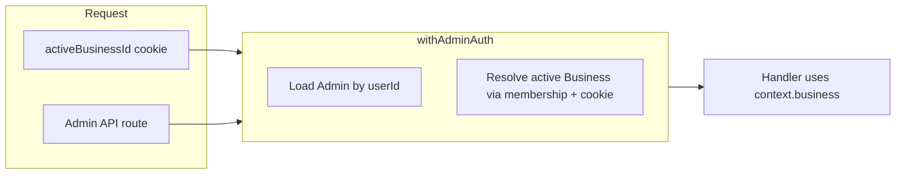

## Also check ./multi-business-per-admin.plan.md

name: Admin multi-business schema
overview: "Today each `Admin` row has a required `businessId`, so one user (1:1 `Admin`) maps to exactly one business. To support one admin user across many businesses, introduce an explicit admin–business membership (join table), migrate existing rows, and resolve a single “active” business per request (recommended: cookie validated in shared auth middleware so ~all existing `withAdminAuth` routes keep using `context.business` unchanged)."
todos:

- id: schema-join
  content: Add Admin↔Business join model; remove businessId from Admin; update Business relations; write data backfill migration
  status: pending
- id: middleware-active-biz
  content: Implement active business resolution (cookie + membership validation) in withAdminAuth / optional variant; add cookie helpers
  status: pending
- id: onboarding-multi
  content: "Refactor onboarding route: Admin upsert + join row; fix slug conflict / ownership checks"
  status: pending
- id: api-list-switch
  content: Add list + switch-business API (or extend business/current) and wire React Query + sidebar switcher
  status: pending
- id: server-pages-actions
  content: Update campaigns/create/[id]/page.tsx and checkAdminHasBusiness to use shared active-business resolver
  status: pending
  isProject: false

---

# One admin user → many businesses

## Current model (what breaks)

In `[packages/prisma/prisma/schema.prisma](packages/prisma/prisma/schema.prisma)`, `Admin` carries a required `businessId` and `userId` is `@unique`, so **one `User` has at most one `Admin` row and that row points to one `Business`**.

```43:58:packages/prisma/prisma/schema.prisma
model Admin {
  id String @id @default(uuid())

  userId String @unique
  user   User   @relation(fields: [userId], references: [id], onDelete: Cascade)

  // Admin must belong to a Business
  businessId String
  business   Business @relation(fields: [businessId], references: [id], onDelete: Cascade)
  // ...
}
```

`[packages/prisma/prisma/models/business.prisma](packages/prisma/prisma/models/business.prisma)` already has `admins Admin[]`; that relation shape will change once `Admin` no longer owns `businessId` directly.

## Recommended schema change

**Keep `User` ↔ `Admin` as 1:1** (still one `Admin` identity per admin user). **Move the business link to a join model**, e.g. `AdminBusiness` (names flexible):

- `Admin`: `id`, `userId` (still `@unique`), timestamps — **remove `businessId` / `business`**
- `AdminBusiness`: `adminId`, `businessId`, `@@unique([adminId, businessId])`, optional fields later (`role`, `createdAt`)
- `Business`: replace `admins Admin[]` with something like `adminMemberships AdminBusiness[]` (and optionally a convenience relation if you want)

**Data migration (SQL or Prisma migration steps):**

1. Create join table.
2. For each existing `admin` row: `INSERT` into join with `(adminId, businessId)`.
3. Drop `businessId` column / FK from `admin`.

This preserves existing semantics: every current admin keeps access to their current business.

## Request-time “active business” (critical)

Almost every admin API already receives a fully scoped `context.business` from `[apps/web/src/lib/auth/middleware.ts](apps/web/src/lib/auth/middleware.ts)` via `withAdminAuth` / `withAdminAuthOptionalBusiness`. Today that context is built by `db.admin.findFirst({ where: { userId }, include: { business } })`, which assumes **one row implies one business**.

After the change, middleware must:

1. Load `Admin` by `userId`.
2. Load **all** businesses the admin can access (via join), or load **one** selected business.
3. **Select active business** using an explicit rule, for example (recommended default): read `activeBusinessId` from an **HTTP-only cookie**, verify it is in the admin’s membership set; if missing/invalid, fall back to a deterministic default (e.g. first membership by `createdAt`) and optionally set the cookie.

That way **~90+ route handlers that only use `context.business.id` do not need rewrites** — only the auth layer and a few server components that bypass it need updates.

**Alternative:** put `businessSlug` in the URL for all dashboard routes; then middleware derives active business from the path instead of a cookie. Higher routing refactor cost.



## Code touchpoints (by area)

### Prisma / DB

- `[packages/prisma/prisma/schema.prisma](packages/prisma/prisma/schema.prisma)` — refactor `Admin`; add join model; update `[packages/prisma/prisma/models/business.prisma](packages/prisma/prisma/models/business.prisma)` relations.
- New migration under `packages/prisma/prisma/migrations/` (you run migrate/generate locally per your workflow).

### Central auth (must change)

- `[apps/web/src/lib/auth/middleware.ts](apps/web/src/lib/auth/middleware.ts)` — replace single-business `include: { business }` with membership resolution + cookie validation; extend `AdminAuthContext` if you surface `adminBusinesses` for the client (optional).
- Cookie name/options: align with `[apps/web/src/lib/utils/cookie.ts](apps/web/src/lib/utils/cookie.ts)` (same-site, path, prefix patterns as existing admin session).

### APIs that create or assume admin–business linkage

- `[apps/web/src/app/api/onboarding/route.ts](apps/web/src/app/api/onboarding/route.ts)` — today creates `Business`, then `admin.create({ userId, businessId })`, and checks slug conflicts with `include: { admins: { where: { userId } } }`. After the change:
  - On first business: `upsert` or `create` `Admin` **without** `businessId`, then `create` join row `{ adminId, businessId }`.
  - On additional business for same user: **do not** create a second `Admin`; only `Business` + join row.
  - Slug conflict check becomes “does this user already have membership on this business slug?” (query via join).
- New endpoints (typical): **list businesses** for switcher (`GET /api/business/list` or expand `GET /api/business/current`), and **switch active** (`POST` that sets cookie after membership check).

### Server components / actions that bypass `withAdminAuth`

These duplicate “load admin → businessId” and must use the **same active-business resolution** as middleware (extract a small helper e.g. `resolveAdminActiveBusiness({ userId, cookies })` to avoid drift):

- `[apps/web/src/app/(business)/campaigns/create/[id]/page.tsx](<apps/web/src/app/(business)`/campaigns/create/[id]/page.tsx>) — loads `admin.businessId` to authorize `campaign` row.
- `[apps/web/src/lib/actions/auth.ts](apps/web/src/lib/actions/auth.ts)` — `checkAdminHasBusiness` should mean “admin has ≥1 membership”, not “admin row exists” (after schema, bare `Admin` might exist without businesses if you allow that edge case).

### Frontend

- `[apps/web/src/hooks/business/useCurrentBusiness.ts](apps/web/src/hooks/business/useCurrentBusiness.ts)` — continues to hit `/api/business/current` but that route’s **meaning** becomes “active business”; add hook/query for **all businesses** + switcher UI (likely `[apps/web/src/components/layouts/AppLayout/components/simple-sidebar.tsx](apps/web/src/components/layouts/AppLayout/components/simple-sidebar.tsx)` or header).
- After switching business, invalidate React Query keys that embed business-scoped data (anything keyed on `/api/...` responses that change per business).

### Proxy / route protection

- `[apps/web/src/proxy.ts](apps/web/src/proxy.ts)` — still only checks admin session; **no business id required** for page access. Optional: if you require a valid `activeBusinessId` cookie for `(business)` pages, add redirect to a “pick business” page when user has memberships but no valid cookie.

### “All APIs that need checking”

**Pattern-based answer:** Every file under `apps/web/src/app/api/**/route.ts` that wraps handlers with `withAdminAuth` or `withAdminAuthOptionalBusiness` (dozens of routes — grep shows broad usage across campaigns, customers, bills, analytics, partnership, shopify, etc.) **depends on correct `context.business`**. Once middleware resolves active business from membership + cookie, those handlers stay logically correct **if** the cookie is always set for normal dashboard use.

**Explicit non-middleware checks to update:** the campaign server page and onboarding route above; any future server component that queries by `admin.businessId` (currently only those few `db.admin` call sites).

### Out of scope for this relationship change

- **Cashier** remains tied to a single `businessId` on `[Cashier](packages/prisma/prisma/schema.prisma)` — unchanged unless you later want multi-business cashiers.
- **Customer** flows are per-business slug already.

## Risk / testing checklist

- User with two businesses: APIs must never leak data across businesses (membership check on every request).
- Onboarding: second business creation for same user must not violate `userId @unique` on `Admin`.
- Logout: clear active-business cookie together with session if desired.
- Existing integrations (Shopify OAuth state, R2 keys): they already key off `context.business.id` from middleware — OK once context is correct.
