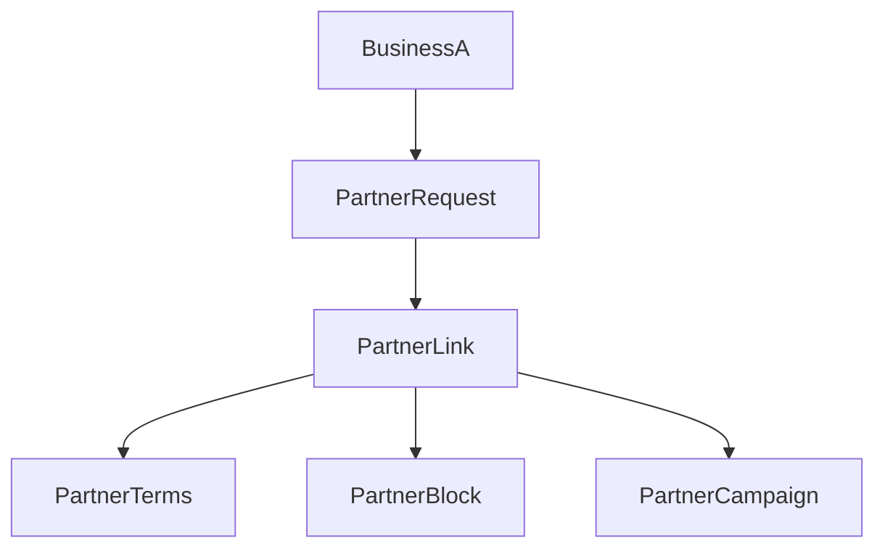

## Plan

- Data model: extend [packages/prisma/prisma/models/business.prisma](packages/prisma/prisma/models/business.prisma) with `maxPartnerAllowed` (default 1) and `receivePartnershipOffers` toggle; add partner tables (requests, active links, terms, permanent blocks, partner campaigns) in [packages/prisma/prisma/models/](packages/prisma/prisma/models/) capturing directional ratios (points and cashback), optional free-item offers (SKU or custom text), initiator business, status (pending/accepted/rejected/permanent), and a block record that enforces “permanent reject until moved back to rejected”; keep partner campaigns as shared single UUID visible to both businesses with optional per-partner overrides.
- API surface: new handlers under `apps/web/src/app/api/partners/**` for (a) settings toggle + maxPartnerAllowed update, (b) send request by target business slug, (c) accept/reject/permanent-block/unblock actions with `maxPartnerAllowed` enforcement, (d) list tables (pending/accepted/rejected/permanent) scoped to admin business, (e) update partnership terms (directional ratios + free-item offers), (f) CRUD for partnership campaigns (create/read in both businesses). Use Zod validation, session scoping, and consistent response shapes per component rules.
- Client hooks: add `usePartners` (fetch lists + mutations) in `apps/web/src/hooks/partners/` handling queryKeys per table, optimistic placeholderData, and error-toasts via `sanitizeErrorMessage` helpers.
- Settings UI: new page `apps/web/src/app/(business)/settings/partners/page.tsx` with `_components/PartnersPageClient.tsx` showing: receive-offers toggle, maxPartnerAllowed input, send-request-by-slug form, tables for pending/accepted/rejected/permanent (with downgrade from permanent→rejected only), accepted table includes editable directional ratios (points, cashback) and free-item offer picker (SKU autocomplete + custom text), and partner campaign list/create section. Wire sidebar entry and route metadata per component architecture rules.
- Loyalty/campaign safeguards: gate any loyalty-side usage behind partnership status and maxPartnerAllowed checks; keep point/cashback application read-only for now (persist terms but don’t alter existing earn/redeem logic) to avoid regression. Highlight risks and add TODOs for later wallet integration before enabling spend sharing.

