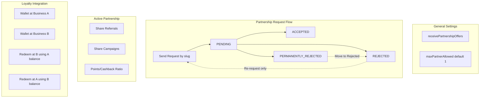

# Connect with Partners - Implementation Plan

## Architecture Overview



---

## 1. Prisma Schema Changes

**Location:** [packages/prisma/prisma/models/](packages/prisma/prisma/models/)

### 1.1 Business model updates ([business.prisma](packages/prisma/prisma/models/business.prisma))

Add fields:

```prisma
receivePartnershipOffers Boolean @default(true)  // If false, no one can send requests
maxPartnerAllowed        Int    @default(1)     // Max partners (1 = exclusive partnership)
```

Add relations: `partnershipsAsA`, `partnershipsAsB`, `partnershipRequestsSent`, `partnershipRequestsReceived`, `partnershipBlocksReceived`.

### 1.2 New models

**PartnershipRequest** (request flow):

- `id`, `requesterBusinessId`, `targetBusinessId`, `status` (enum: PENDING | ACCEPTED | REJECTED | PERMANENTLY_REJECTED)
- `respondedAt`, `createdAt`, `updatedAt`
- Unique on `(requesterBusinessId, targetBusinessId)` - one active request per pair; history via status
- When ACCEPTED: create Partnership, mark request as accepted

**Partnership** (active partnership - relational, no partyA/partyB ordering):

- `id`, `businessAId`, `businessBId` (enforce `businessAId < businessBId` in app to avoid duplicates)
- `shareReferrals` (both must agree - store as single boolean; both must opt-in via separate agreement flow or single "agreed" when both accepted)
- `shareCampaigns` (same)
- `pointsRatioFromA` Float (1 point/cashback at A = X value when used at B)
- `pointsRatioFromB` Float (1 point/cashback at B = Y value when used at A)
- `createdAt`, `updatedAt`
- `@@unique([businessAId, businessBId])`

**PartnershipBlock** (permanently rejected - who cannot send to whom):

- `blockerBusinessId`, `blockedBusinessId` - B permanently rejected A, so A is blocked from sending to B
- `createdAt`
- `@@unique([blockerBusinessId, blockedBusinessId])`
- "Move to rejected" = delete this block; then A can send new request

**PartnershipCampaign** (shared campaign - new model, not Campaign category):

- `id`, `slug` (unique), `partnershipId`
- Campaign-like fields: `title`, `description`, `rewardType`, `rewardValue`, `expiresAt`, `status`, `themeColor`, etc.
- `createdByBusinessId` (who created it)
- Both businesses see it via partnership; single UUID

### 1.3 Enums

Add to [enums.prisma](packages/prisma/prisma/models/enums.prisma):

```prisma
enum PartnershipRequestStatus {
  PENDING
  ACCEPTED
  REJECTED
  PERMANENTLY_REJECTED
}
```

---

## 2. General Settings: Receive Partnership Offers

**Location:** [BusinessExistingSettings.tsx](apps/web/src/components/settings/business/BusinessExistingSettings.tsx)

- Add a new "Partnership" card/section with:
  - Switch: "Receive business partnership offers" (maps to `receivePartnershipOffers`)
  - Number input: "Max partners allowed" (default 1, min 1)
- Extend `updateBusiness` schema and API to accept these fields.
- Add to [business.ts](apps/web/src/lib/schemas/business.ts) schema.

---

## 3. Settings Page: Connect with Partners

**Location:** `apps/web/src/app/(business)/settings/partners/`

### 3.1 Route and layout

- Add nav item in [settings/layout.tsx](<apps/web/src/app/(business)/settings/layout.tsx>): "Connect with Partners" (e.g. Handshake icon)
- Create `settings/partners/page.tsx` and `_components/PartnersSettingsPageClient.tsx`

### 3.2 Page sections

1. **Send partner request**

- Input: target business slug
- Validate: target exists, has `receivePartnershipOffers=true`, not blocked, not already partnered, not already pending
- API: `POST /api/partnership/request` with `{ targetBusinessSlug }`

1. **Incoming requests** (table)

- Rows: requester business name/slug, status, actions
- Actions: Accept | Reject | Reject Permanently
- API: `GET /api/partnership/requests` (incoming), `PATCH /api/partnership/requests/[id]` (respond)

1. **Permanently rejected** (table)

- Rows: blocked business name/slug
- Action: "Move to Rejected" (removes block; they can re-request)
- API: `DELETE /api/partnership/blocks/[blockedBusinessId]` or similar

1. **Active partner** (if `maxPartnerAllowed=1` and partnered)

- Show partner name, slug
- Toggles: Share referrals (both agree), Share campaigns (both agree)
- Ratio inputs: points/cashback ratio from each side
- API: `PATCH /api/partnership/[id]` for agreement and ratio updates

1. **Send request from your side**

- If you previously rejected someone and they want to partner: they must send a new request. You cannot "accept" from rejected; only they can re-request.

---

## 4. API Routes

**Base:** `apps/web/src/app/api/partnership/`

| Route                         | Method     | Purpose                                     |
| ----------------------------- | ---------- | ------------------------------------------- |
| `/request`                    | POST       | Send request (body: `targetBusinessSlug`)   |
| `/requests`                   | GET        | List incoming/outgoing requests             |
| `/requests/[id]`              | PATCH      | Respond: accept, reject, reject permanently |
| `/blocks`                     | GET        | List permanently rejected (blocked)         |
| `/blocks/[blockedBusinessId]` | DELETE     | Move to rejected (remove block)             |
| `/[partnershipId]`            | GET, PATCH | Get/update partnership (agreements, ratios) |
| `/current`                    | GET        | Current partnership for business            |

All routes use `withAdminAuth` and `context.business.id`.

---

## 5. Referral Sharing

**Location:** [api/referral/claim/route.ts](apps/web/src/app/api/referral/claim/route.ts)

When a referral is claimed via Business A's link:

1. Create `BusinessCustomer` for A (existing behavior).
2. If A has active partnership with B and `shareReferrals=true`:

- Create `BusinessCustomer` for B (same customer, `referredBy` = referrer from A).
- Create `Wallet` for B if missing.
- Do not double-apply referral rewards; rewards follow A's program (referrer's business).

---

## 6. Partnership Campaigns

**Location:** New model + API + UI

- `PartnershipCampaign` model (see 1.2).
- API: `GET /api/partnership/campaigns`, `POST /api/partnership/campaigns`, `PATCH /api/partnership/campaigns/[id]`.
- Campaigns list: extend to show partnership campaigns (from `partnershipId` where this business is partner).
- No `partnership_campaign` category on Campaign; keep as separate model.

---

## 7. Loyalty Cross-Redemption (Partner Points/Cashback)

**Location:** [lib/actions/loyalty/index.ts](apps/web/src/lib/actions/loyalty/index.ts), [lib/loyalty/redeem-info.ts](apps/web/src/lib/loyalty/redeem-info.ts)

**Flow:** User redeems at Business B using balance from partner Business A.

1. **Redeemable info:** When computing redeemable for a bill at B, also check:

- B's active partnership with A.
- Customer's wallet at A.
- Apply `pointsRatioFromA` (or cashback equivalent) to convert A's balance to B's discount value.

1. **Redemption:** When redeeming partner balance at B:

- Deduct from A's wallet (cashback or points).
- Create Transaction for A (REDEEMED, source=PARTNER_REDEMPTION, metadata: `{ partnerBusinessId: B, billId }`).
- Apply discount at B.

**New TransactionSource:** Add `PARTNER_REDEMPTION` to `TransactionSource` enum.

**Ratio semantics:**

- Cashback: 1 rupee at A = `pointsRatioFromA` rupees at B.
- Points: 1 point at A = X rupees at B (use business A's conversion rate × ratio).

**Risks:** See section 9.

---

## 8. File Summary

| Area      | Files to create/modify                                                                |
| --------- | ------------------------------------------------------------------------------------- |
| Prisma    | `business.prisma`, new `partnership.prisma`, `enums.prisma`, `schema.prisma`          |
| Settings  | `settings/layout.tsx`, `settings/partners/page.tsx`, `settings/partners/_components/` |
| General   | `BusinessExistingSettings.tsx`, `business/settings` schema                            |
| API       | `api/partnership/`, `api/referral/claim/route.ts`                                     |
| Loyalty   | `lib/actions/loyalty/index.ts`, `lib/loyalty/redeem-info.ts`                          |
| Campaigns | `api/partnership/campaigns/`, campaigns list UI                                       |

---

## 9. Risks and Mitigations

| Risk                                   | Impact                                                          | Mitigation                                                                                                                                                                                                   |
| -------------------------------------- | --------------------------------------------------------------- | ------------------------------------------------------------------------------------------------------------------------------------------------------------------------------------------------------------ |
| **Loyalty type mismatch**              | A has CASHBACK, B has AMOUNT_SPENT; conversion logic is complex | Define ratio as "1 rupee at A = X rupees at B" for cashback; for points, use A's conversion (1 pt = Y rupees) × ratio. Phase 1: support only cashback-to-cashback and points-to-points with same conversion. |
| **Double redemption**                  | Customer redeems at both A and B simultaneously                 | Ensure one redemption per bill; existing logic already enforces one cashback redemption per bill. Partner redemption counts as that same redemption.                                                         |
| **Referral reward confusion**          | Partner business gets customer but no reward                    | Document: only referrer's business gives the reward. Partner business just gets the customer.                                                                                                                |
| **Race on maxPartnerAllowed**          | Two requests accepted at same time                              | Use DB transaction + unique constraint; check before accept.                                                                                                                                                 |
| **Permanently rejected UX**            | "Move to rejected" unclear                                      | Clear label: "Allow them to send a new request" and tooltip.                                                                                                                                                 |
| **Bill creation from Shopify/cashier** | Partner redemption not wired                                    | Cashier bill creation and Shopify order loyalty must both call the extended loyalty flow that supports partner redemption.                                                                                   |

---

## 10. Implementation Order

1. Prisma schema + migration
2. General settings (receivePartnershipOffers, maxPartnerAllowed)
3. Partners settings page + API (request flow, blocks)
4. Partnership model + agreements (shareReferrals, shareCampaigns, ratios)
5. Referral sharing
6. Partnership campaigns
7. Loyalty cross-redemption (highest risk; do last)

---

## 11. Clarifications Resolved

- **No partyA/partyB:** Use `businessAId`/`businessBId` with `businessAId < businessBId` in app to avoid ordering.
- **No partnership_campaign category:** Use separate `PartnershipCampaign` model.
- **Permanently rejected:** Stored in `PartnershipBlock`; "Move to rejected" = delete block.
- **Re-request:** From permanently rejected, only the blocker can "Move to rejected"; then the blocked business must send a new request.
