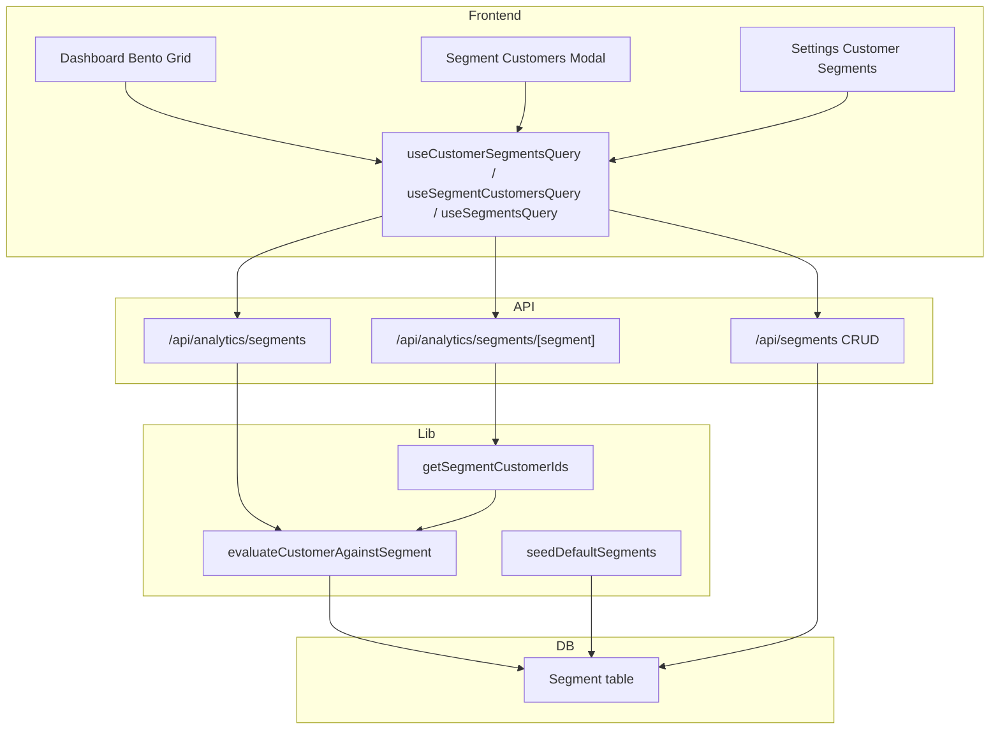

# Customer Segmentation System

## Summary

Remove RFM terminology and implement a configurable segmentation system. Each segment is stored in the DB with recency, frequency, and monetary filters that admins can customize in Settings. Default segments (Loyal, VIP, Lost, etc.) are seeded per business; admins can edit thresholds or create custom segments. Classification reads from DB config; dashboard shows bento grid with percentage, count, name, and info button.

---

## Segment Definitions (Recency / Frequency / Monetary)

Data sources: `Wallet` ([visitCount](packages/prisma/prisma/models/wallet.prisma) for frequency, lifetimeSpend, lastVisitAt), `Bill` (last purchase date), `BusinessCustomer` (createdAt).

**Frequency source:** Use `Wallet.visitCount` ([wallet.prisma:33-36](packages/prisma/prisma/models/wallet.prisma)) for all frequency filters. No other source.

| Segment                | Recency      | Frequency          | Monetary         | Description                                                  |
| ---------------------- | ------------ | ------------------ | ---------------- | ------------------------------------------------------------ |
| **Loyal**              | 90-180 days  | High (4+)          | High (>1.5x avg) | Frequent, high spend, haven't visited in a while             |
| **VIP**                | ≤90 days     | Medium (5+ visits) | 3x avg spend     | Recent, spend 3x avg; 5+ visits (Wallet.visitCount)          |
| **Lost**               | 365+ days    | Low                | Low              | Rarely visited, spent least                                  |
| **Can't Loose**        | 90-180 days  | High (10+)         | High             | Frequent, high spend, been a while                           |
| **About to sleep**     | 90-180 days  | Low (1-3)          | Low              | Visited sometime back, low frequency, low spend              |
| **At Risk**            | 180-365 days | Medium             | Medium           | Average spend, haven't visited recently                      |
| **Potential Loyalist** | ≤60 days     | Low (1-3)          | Medium           | Recent, not frequent, average spend                          |
| **Promising**          | ≤60 days     | Low                | Low              | Recent, low spend                                            |
| **Needs Attention**    | 90-180 days  | Occasional (2-3)   | Medium           | Occasional visits, average spend, haven't purchased recently |

---

## Configurable Segment Schema (Prisma)

Admins get control over recency, frequency, and monetary thresholds via Settings. Defaults are seeded; admins can edit or create custom segments.

### New Enums (enums.prisma)

```prisma
enum SegmentOperator {
  LESS_THAN
  GREATER_THAN
  LESS_THAN_OR_EQUAL
  GREATER_THAN_OR_EQUAL
  IN_RANGE
  NOT_IN_RANGE
}

enum RecencyUnit {
  DAYS
  MONTHS
}
```

### New Model: Segment (packages/prisma/prisma/models/segment.prisma)

```prisma
model Segment {
  id         String   @id @default(uuid())
  businessId String
  business   Business @relation(fields: [businessId], references: [id], onDelete: Cascade)

  name        String  // Display name, unique per business
  slug        String  // URL-safe: "vip", "cant-loose", unique per business
  description String?
  proTip      String?

  // Recency: days since last visit (lastVisitAt ?? lastBillDate ?? createdAt)
  recencyOperator SegmentOperator?
  recencyValue    Float?
  recencyValue2   Float?   // For IN_RANGE / NOT_IN_RANGE
  recencyUnit     RecencyUnit? @default(DAYS)

  // Frequency: Wallet.visitCount (number of visits)
  frequencyOperator SegmentOperator?
  frequencyValue    Int?
  frequencyValue2  Int?

  // Monetary: ratio = lifetimeSpend / avgSpend (e.g. 3 = 3x avg)
  monetaryOperator SegmentOperator?
  monetaryValue    Float?
  monetaryValue2   Float?

  sortOrder Int @default(0)  // Evaluation order (first match wins)
  isSystem  Boolean @default(false)  // Predefined; can edit, cannot delete

  createdAt DateTime @default(now())
  updatedAt DateTime @updatedAt

  @@unique([businessId, name])
  @@unique([businessId, slug])
  @@index([businessId])
  @@map("segment")
}
```

Add `segments Segment[]` to Business model.

### Filter Evaluation Rules

- **Null = no filter:** If recencyOperator is null, recency is not checked (pass).
- **Recency:** Convert value to days (MONTHS × 30.44). Compare `daysSinceVisit` to threshold.
- **Frequency:** Compare `Wallet.visitCount` to value(s).
- **Monetary:** Compare `lifetimeSpend / avgSpend` to value(s). Supports both high (3x) and low (0.5x).
- **IN_RANGE:** value <= x <= value2. **NOT_IN_RANGE:** x < value OR x > value2.

### Default Segment Seed

Migration or seed script inserts 9 default segments per business. `isSystem: true`. Example defaults:

| Slug               | Recency                         | Frequency                | Monetary                |
| ------------------ | ------------------------------- | ------------------------ | ----------------------- |
| lost               | GREATER_THAN_OR_EQUAL 365, DAYS | (none)                   | LESS_THAN 0.5           |
| vip                | LESS_THAN_OR_EQUAL 90, DAYS     | GREATER_THAN_OR_EQUAL 5  | GREATER_THAN_OR_EQUAL 3 |
| loyal              | IN_RANGE 90, 180, DAYS          | GREATER_THAN_OR_EQUAL 4  | GREATER_THAN 1.5        |
| cant-loose         | IN_RANGE 90, 180, DAYS          | GREATER_THAN_OR_EQUAL 10 | GREATER_THAN 1.5        |
| about-to-sleep     | IN_RANGE 90, 180, DAYS          | IN_RANGE 1, 3            | LESS_THAN 0.5           |
| at-risk            | IN_RANGE 180, 365, DAYS         | (none)                   | IN_RANGE 0.5, 1.5       |
| potential-loyalist | LESS_THAN_OR_EQUAL 60, DAYS     | IN_RANGE 1, 3            | IN_RANGE 0.5, 1.5       |
| promising          | LESS_THAN_OR_EQUAL 60, DAYS     | (none)                   | LESS_THAN 0.5           |
| needs-attention    | IN_RANGE 90, 180, DAYS          | IN_RANGE 2, 3            | IN_RANGE 0.5, 1.5       |

**Uncategorized:** Add optional 10th segment with no filters (matches all) as last in sortOrder, or assign non-matching customers to "Uncategorized" in UI. Recommend: ensure segment rules cover all cases or add catch-all.

---

## Architecture



---

## Implementation Plan

### 0. Prisma: Segment Model + Migration

- Add enums `SegmentOperator`, `RecencyUnit` to [packages/prisma/prisma/models/enums.prisma](packages/prisma/prisma/models/enums.prisma).
- Create [packages/prisma/prisma/models/segment.prisma](packages/prisma/prisma/models/segment.prisma) with Segment model.
- Add `segments Segment[]` to Business in [packages/prisma/prisma/models/business.prisma](packages/prisma/prisma/models/business.prisma).
- Create migration. Add seed script or migration step to insert default segments for existing businesses (and ensure new businesses get them via app logic or migration).

### 1. Server-Only Lib: `lib/segmentation/`

Create [apps/web/src/lib/segmentation/](apps/web/src/lib/segmentation/).

**Files:**

- `**types.ts` – Segment config types, operator enums.
- `**defaults.ts` – Default segment definitions (name, slug, description, proTip, recency/frequency/monetary defaults) for seeding.
- `**evaluate.ts` – `evaluateSegment(customerData, segment, avgSpend): boolean`. Applies segment's recency/frequency/monetary rules. `matchesOperator(value, op, v1, v2)` helper.
- `**classify.ts` – `classifyCustomer(wallets, segmentConfigs, lastBillMap, customerCreatedMap, now, avgSpend): string` (segment slug). Loads segments from DB (or uses defaults if none), evaluates each customer against segments in sortOrder; first match wins.
- `**get-segment-ids.ts` – `getSegmentCustomerIds(businessId, segmentSlug)` – fetches segments from DB, runs classification, returns `customerId[]` for that slug.
- `**seed.ts` – `seedDefaultSegments(businessId)` – inserts default segments if business has none. Call on business creation or lazily when segments API is first hit.

### 2. API Routes

**Overview API:** [apps/web/src/app/api/analytics/segments/route.ts](apps/web/src/app/api/analytics/segments/route.ts)

- `GET` – Returns `{ totalCustomers, segments: [{ name, slug, count, percentage, description, proTip }] }`.
- Ensures defaults are seeded (call `seedDefaultSegments` if no segments). Loads segments from DB, runs classification, aggregates counts.

**Segment customers API:** [apps/web/src/app/api/analytics/segments/[segment]/route.ts](apps/web/src/app/api/analytics/segments/[segment]/route.ts)

- `GET` – Paginated list of customers for segment (by slug).
- Query params: `page`, `perPage`, `name`, `email`, `sort`.
- Flow: `getSegmentCustomerIds(businessId, segmentSlug)` → `customerId[]` → apply filters → `findMany` with skip/take.

**Segments CRUD API:** [apps/web/src/app/api/segments/route.ts](apps/web/src/app/api/segments/route.ts)

- `GET` – List all segments for business (for Settings page).
- `POST` – Create custom segment. Validate schema (name, slug, recency/frequency/monetary config).

[apps/web/src/app/api/segments/[id]/route.ts](apps/web/src/app/api/segments/[id]/route.ts)

- `GET` – Single segment.
- `PUT` – Update segment (thresholds, description, proTip). System segments: allow edit; custom: full edit.
- `DELETE` – Delete only if `!isSystem`.

### 3. Schemas

- `**lib/schemas/segment.ts` – `segmentParamSchema` (slug), `segmentCustomersQuerySchema`, `createSegmentSchema`, `updateSegmentSchema` (name, slug, description, proTip, recency/frequency/monetary operator + values).

### 4. Hooks

Extend [apps/web/src/hooks/analytics/useAnalyticsQuery.ts](apps/web/src/hooks/analytics/useAnalyticsQuery.ts) and create [apps/web/src/hooks/segments/useSegmentsQuery.ts](apps/web/src/hooks/segments/useSegmentsQuery.ts):

- `**useCustomerSegmentsQuery()` – Fetches overview API. QueryKey: `["analytics", "segments"]`.
- `**useSegmentCustomersQuery(segment, queryString)` – Fetches segment customers API.
- `**useSegmentsQuery()` – Fetches `GET /api/segments` for Settings (list of segment configs).
- `**useSegmentMutation()` – Create/update/delete segment (invalidates segments + analytics queries).

### 5. Types

Update [apps/web/src/lib/types/analytics.ts](apps/web/src/lib/types/analytics.ts):

- Add `CustomerSegment` type: `{ name, count, percentage, description?, proTip? }`.
- Add `CustomerSegmentsResponse`: `{ totalCustomers, segments: CustomerSegment[] }`.
- Add `SegmentCustomersResponse`: `{ items, total, page, perPage }` (reuse customer item shape).

### 6. Dashboard UI: Bento Grid

Refactor [apps/web/src/components/dashboard/sections/RfmSection.tsx](apps/web/src/components/dashboard/sections/RfmSection.tsx):

- Rename to **CustomerSegmentationSection** (or keep `RfmSection` filename but change content).
- Remove all RFM wording from title/description.
- Use `useCustomerSegmentsQuery()` for data.
- **Bento grid layout:** CSS Grid with variable cell sizes (e.g. `grid-cols-4`, `col-span-2 row-span-2` for larger segments like VIP, Loyal, Can't Loose).
- **Segment card:** Name, percentage, count, small info button (e.g. `InfoIcon` from [packages/ui/src/components/info-icon.tsx](packages/ui/src/components/info-icon.tsx)). Info content: description + pro-tip. `InfoIcon` accepts `content: string`; for multi-line use `description + "\n\nPro-tip: " + proTip` or extend with a Popover for richer content.
- **Click behavior:** Each card links to or opens a modal/drawer showing the segment’s customer list. Use `useSegmentCustomersQuery` inside the modal with `useSearchParams` or local state for pagination/filters. Filtering and pagination apply only to that segment’s customers.

### 7. Settings Page: Customer Segments

Create [apps/web/src/app/(business)/settings/segments/](<apps/web/src/app/(business)/settings/segments/>):

- **page.tsx** – Server component with metadata.
- **components/SegmentsSettingsPageClient.tsx** – List of segments with edit/create.
- **Segment form:** Name, slug (auto-derived from name or editable), description, proTip. For each dimension (Recency, Frequency, Monetary): Operator dropdown (LESS_THAN, GREATER_THAN, IN_RANGE, etc.), Value, Value2 (required for IN_RANGE/NOT_IN_RANGE), Unit (Recency only: DAYS/MONTHS). "Clear" to remove filter (null = no filter). Helper text: "Recency = days since last visit", "Frequency = Wallet.visitCount (number of visits)", "Monetary = multiple of average spend (e.g. 3 = 3x)".
- **List UI:** Table or cards showing each segment with its config summary. Edit button opens form (inline or modal). "Add custom segment" for new. System segments show lock icon; Delete disabled for them.
- Add sidebar item in [simple-sidebar.tsx](apps/web/src/components/layouts/AppLayout/components/simple-sidebar.tsx) under Settings.
- Add route metadata and `protectedAdminRoutes` for `/settings/segments`.

### 8. Segment Customers Modal / Drawer

- New component: `SegmentCustomersModal` or `SegmentCustomersDrawer`.
- Props: `segment`, `open`, `onOpenChange`.
- Renders a table (reuse existing customer table patterns from [apps/web/src/app/(business)/customers](<apps/web/src/app/(business)/customers>)) with pagination and search.
- Uses `useSegmentCustomersQuery(segment, queryString)` where `queryString` comes from URL params or local state.

### 8. Cleanup

- Remove or deprecate [apps/web/src/app/api/analytics/rfm/route.ts](apps/web/src/app/api/analytics/rfm/route.ts) after migration.
- Update `useRfmQuery` to `useCustomerSegmentsQuery` and remove `useRfmQuery` if unused elsewhere.
- Update [DashboardPageClient](apps/web/src/components/dashboard/DashboardPageClient.tsx) import if section is renamed.

---

## File Summary

| Action           | Path                                                                          |
| ---------------- | ----------------------------------------------------------------------------- |
| Create           | `packages/prisma/prisma/models/segment.prisma`                                |
| Update           | `packages/prisma/prisma/models/enums.prisma` (SegmentOperator, RecencyUnit)   |
| Update           | `packages/prisma/prisma/models/business.prisma` (segments relation)           |
| Create           | `lib/segmentation/types.ts`                                                   |
| Create           | `lib/segmentation/defaults.ts`                                                |
| Create           | `lib/segmentation/evaluate.ts`                                                |
| Create           | `lib/segmentation/classify.ts`                                                |
| Create           | `lib/segmentation/get-segment-ids.ts`                                         |
| Create           | `lib/segmentation/seed.ts`                                                    |
| Create           | `lib/segmentation/index.ts`                                                   |
| Create           | `lib/schemas/segment.ts`                                                      |
| Create           | `app/api/analytics/segments/route.ts`                                         |
| Create           | `app/api/analytics/segments/[segment]/route.ts`                               |
| Create           | `app/api/segments/route.ts`                                                   |
| Create           | `app/api/segments/[id]/route.ts`                                              |
| Update           | `lib/types/analytics.ts`                                                      |
| Update           | `hooks/analytics/useAnalyticsQuery.ts`                                        |
| Create           | `hooks/segments/useSegmentsQuery.ts`                                          |
| Refactor         | `components/dashboard/sections/RfmSection.tsx`                                |
| Create           | `components/dashboard/sections/SegmentCustomersModal.tsx`                     |
| Create           | `app/(business)/settings/segments/page.tsx`                                   |
| Create           | `app/(business)/settings/segments/_components/SegmentsSettingsPageClient.tsx` |
| Update           | `simple-sidebar.tsx`, `route-metadata.ts`, `proxy.ts`                         |
| Remove/Deprecate | `app/api/analytics/rfm/route.ts`                                              |

---

## Threshold Reference (for classify.ts)

- **Recency:** `daysSinceVisit` from `lastVisitAt ?? lastBillDate ?? createdAt`
- **Frequency:** `Wallet.visitCount` ([wallet.prisma:33-36](packages/prisma/prisma/models/wallet.prisma)) – High: ≥10, Medium: 4–9, Low: 1–3, Occasional: 2–3
- **Monetary:** `lifetimeSpend` vs `avgSpend` – High: >1.5x, Medium: 0.5–1.5x, Low: <0.5x
- **Recency buckets:** Recent ≤60, Sometime back 90–180, A while 90–180, Recently (at risk) 180–365, Very long 365+

Order of checks in `classifyCustomer` should respect specificity (e.g. Lost first, then VIP, then others).

**VIP specifics:** Monetary = `lifetimeSpend >= avgSpend * 3`. Frequency = `visitCount >= 5` (Wallet.visitCount). Recency = last visit ≤90 days.
