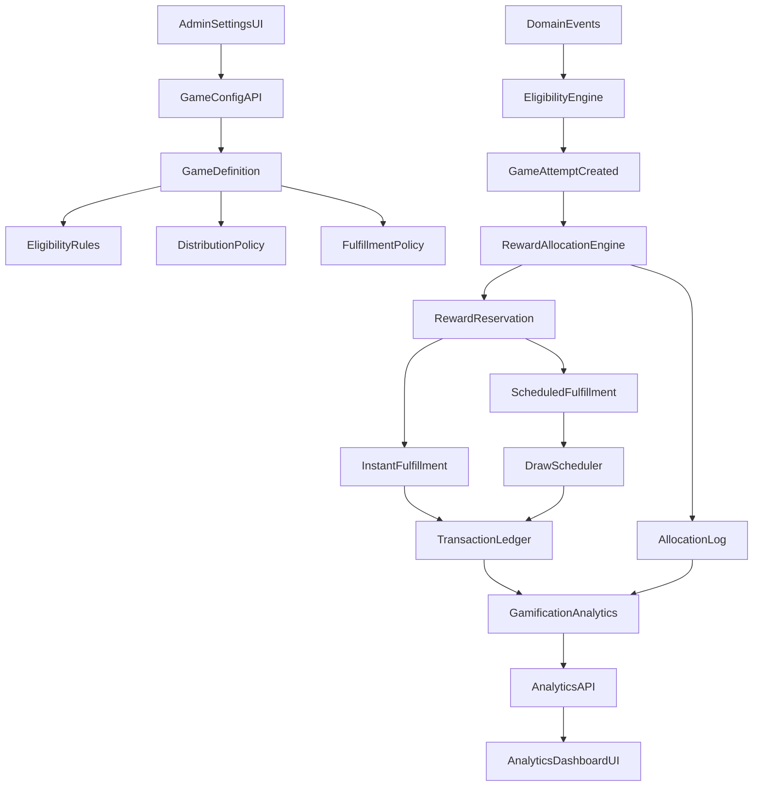

# Games of Chance Detailed Implementation Plan

## Goal and Scope

Implement **Phase 1 games-of-chance only** in your codebase: `Spin the wheel`, `Lotteries`, and `Scratch & win` from [apps/web/Readme.md](/Users/devitaliya/Documents/Code/retention/apps/web/Readme.md), with:

- One common architecture that supports all game types
- Multi-event eligibility triggers (bill, visit interval, campaign actions, referral milestones, custom events)
- Safe reward distribution controls (probability %, user %, fixed winner counts, first N users)
- Instant and delayed fulfillment models
- Strong anti-fraud, auditability, and analytics-by-design

## Existing Codebase Anchors To Reuse

- **Loyalty settings + sectioned updates pattern** in [apps/web/src/app/api/loyalty/route.ts](/Users/devitaliya/Documents/Code/retention/apps/web/src/app/api/loyalty/route.ts)
- **Unified transaction ledger model** in [packages/prisma/prisma/models/transactions.prisma](/Users/devitaliya/Documents/Code/retention/packages/prisma/prisma/models/transactions.prisma)
- **Wallet denormalized balances pattern** in [packages/prisma/prisma/models/wallet.prisma](/Users/devitaliya/Documents/Code/retention/packages/prisma/prisma/models/wallet.prisma)
- **Bill-level earning/redemption linkage** in [packages/prisma/prisma/models/bill.prisma](/Users/devitaliya/Documents/Code/retention/packages/prisma/prisma/models/bill.prisma)
- **Existing scratch-card domain base** in [packages/prisma/prisma/models/scratch_card.prisma](/Users/devitaliya/Documents/Code/retention/packages/prisma/prisma/models/scratch_card.prisma)
- **Analytics endpoint conventions** under [apps/web/src/app/api/analytics](/Users/devitaliya/Documents/Code/retention/apps/web/src/app/api/analytics)

## Industry Inputs Incorporated (OpenLoyalty + Similar Patterns)

Use these as design guardrails:

- OpenLoyalty Fortune Wheels: weighted/randomized prizes and campaign-triggered execution
- OpenLoyalty fraud guidance: layered controls (limits, anomaly monitoring, RBAC, audit logs)
- Proven scratch/lottery patterns: fixed inventory or deterministic draw pools when guaranteed counts are required; avoid naive random-only models for regulated/fixed-budget campaigns

## Target Architecture (Common Engine + Type-Specific Executors)

## Core Domain Design

### 1) Shared Concepts for All Games

Create a unified model so all games share these building blocks:

- `GameCampaign`: one configured game instance (type = WHEEL | LOTTERY | SCRATCH)
- `EligibilityRuleSet`: who can play and when (event-based + interval-based + caps)
- `DistributionPolicy`: how winners are computed
- `RewardPool`: rewards inventory + limits + priority
- `FulfillmentPolicy`: instant vs scheduled (lottery draw time)
- `GameAttempt`: every user attempt with immutable context snapshot
- `RewardAllocation`: outcome and reason (won/lost/ineligible/throttled/exhausted)
- `GameAuditLog`: admin or system action history

### 2) Distribution Policies (Your Requested Scenarios)

Support all four modes (can be combined with precedence rules):

- **Probability by reward**: e.g., Reward X has 5% chance
- **Population ratio**: e.g., 10 out of every 100 eligible users win X
- **Fixed winner count**: e.g., max 200 winners total
- **Sequential cap**: e.g., first 100 users get access/reward

Resolution order for deterministic behavior:

1. Eligibility + throttle checks
2. Campaign budget/stock checks
3. Policy-specific deterministic constraints (first N, max winners, per-user caps)
4. Random/weighted selection only if still allowed
5. Reserve and log outcome atomically

### 3) Instant vs Delayed Fulfillment

- **Scratch/Wheel** default instant: outcome returned in same call
- **Lottery** delayed:
  - entry collected now
  - draw job at configured `drawAt`
  - winner records + fulfillment records created after draw
  - customer notified post-draw

### 4) Computational Logging and Replayability

Add strong auditability to avoid “fundamental random mistakes”:

- Save `seedVersion`, `policySnapshot`, `eligibilitySnapshot`, `attemptOrdinal`, `selectionReason`
- Keep immutable attempt + allocation logs
- Build replay endpoint for internal debug/simulation mode (read-only)

## Detailed DB Schema Changes (Prisma)

### New Enum Models

- `GameType`: `SPIN_WHEEL`, `LOTTERY`, `SCRATCH_CARD`
- `GameCampaignStatus`: `DRAFT`, `ACTIVE`, `PAUSED`, `COMPLETED`, `ARCHIVED`
- `EligibilityEventType`: `BILL_CREATED`, `VISIT_QUALIFIED`, `REFERRAL_COMPLETED`, `CAMPAIGN_ACTION`, `MANUAL_GRANT`, `CUSTOM_EVENT`
- `DistributionMode`: `PROBABILITY_WEIGHTED`, `POPULATION_RATIO`, `FIXED_WINNER_COUNT`, `FIRST_N`
- `FulfillmentMode`: `INSTANT`, `SCHEDULED_DRAW`
- `AttemptOutcome`: `WON`, `NOT_WON`, `INELIGIBLE`, `RATE_LIMITED`, `EXHAUSTED`, `DRAW_PENDING`

### New Tables (recommended names)

- `game_campaign`
  - `id`, `businessId`, `type`, `name`, `status`, `startsAt`, `endsAt`, `timezone`, `priority`, `isStackable`
  - `fulfillmentMode`, `drawAt`, `drawWindowStart`, `drawWindowEnd`
  - `createdBy`, `updatedBy`, timestamps
- `game_eligibility_rule`
  - `campaignId`, `eventType`, `eventFilterJson`, `intervalUnit`, `intervalValue`, `maxAttemptsPerUserPerInterval`, `globalAttemptCap`
  - `firstNEligibleUsers`, `segmentId?`
- `game_distribution_policy`
  - `campaignId`, `mode`, `totalPopulationWindow`, `winnerPopulationCount`, `maxWinnersTotal`, `randomSeedVersion`, `strictInventoryMode`
- `game_reward`
  - `campaignId`, `rewardType`, `rewardRef` (SKU/coupon/points/cashback), `displayName`, `weight`, `probabilityPercent`, `maxWinners`, `stock`, `priority`, `isFallbackNoReward`
- `game_attempt`
  - `campaignId`, `businessId`, `customerId`, `triggerEventType`, `triggerEventId`, `billId?`, `attemptAt`, `attemptOrdinal`, `eligibilitySnapshotJson`
  - unique constraints for anti-duplication by event where needed
- `game_allocation`
  - `attemptId`, `outcome`, `rewardId?`, `allocationReason`, `policySnapshotJson`, `rngTraceJson`, `allocatedAt`
- `game_fulfillment`
  - `allocationId`, `mode`, `status`, `scheduledFor`, `fulfilledAt`, `failureReason`, `deliveryChannel`, `deliveryRef`
- `game_draw_batch` (lottery only)
  - `campaignId`, `scheduledAt`, `executedAt`, `status`, `inputHash`, `winnerCount`, `executionLogJson`
- `game_draw_entry`
  - `campaignId`, `customerId`, `sourceAttemptId`, `entryCount`, `createdAt`
- `game_draw_winner`
  - `drawBatchId`, `customerId`, `rewardId`, `rank`, `notifiedAt`, `claimedAt`
- `game_analytics_daily`
  - pre-aggregated day-level metrics for performance: attempts, eligible, winners, rewardCost, conversion, fraudFlags
- `game_audit_log`
  - admin/system actions, before/after JSON, actor, requestId

### Modify Existing Models

- `Transaction`: add optional relation fields for `gameAllocationId` and/or `gameCampaignId`
- `Wallet`: optional counters for gamification if needed (`gamesPlayedCount`, `gamesWonCount`) or keep in analytics tables
- `BusinessCustomer`: optional denorm fields (`lastGamePlayedAt`, `lastGameWinAt`) if query patterns demand
- **Decision:** keep existing `ScratchCard` models for backward compatibility first, then migrate into `game_campaign` or bridge-map in service layer

### Key Indexes and Constraints

- Composite index on (`businessId`, `customerId`, `campaignId`, `attemptAt`)
- Unique dedupe key for event consumption: (`campaignId`, `customerId`, `triggerEventType`, `triggerEventId`)
- Indexes for draw jobs: (`campaignId`, `scheduledAt`, `status`)
- Check constraints for probability sum, non-negative stock, and cap bounds

## Backend APIs To Add (Complete List)

### Settings/Admin APIs

- `GET /api/games/campaigns` list campaigns + filters
- `POST /api/games/campaigns` create campaign draft
- `GET /api/games/campaigns/:id` get campaign detail
- `PUT /api/games/campaigns/:id` update campaign
- `POST /api/games/campaigns/:id/publish` activate with validation
- `POST /api/games/campaigns/:id/pause`
- `POST /api/games/campaigns/:id/archive`
- `POST /api/games/campaigns/:id/clone`
- `POST /api/games/campaigns/:id/simulate` Monte Carlo + deterministic checks

### Configuration Subresource APIs

- `PUT /api/games/campaigns/:id/eligibility`
- `PUT /api/games/campaigns/:id/distribution`
- `PUT /api/games/campaigns/:id/rewards`
- `PUT /api/games/campaigns/:id/fulfillment`
- `PUT /api/games/campaigns/:id/limits`

### Runtime APIs (customer-facing via bill/event flows)

- `POST /api/games/events/ingest` generic event ingestion (idempotent)
- `POST /api/games/campaigns/:id/attempt` create play attempt + return result (instant or pending)
- `GET /api/games/campaigns/:id/eligibility?customerId=...`
- `GET /api/games/attempts/:attemptId`
- `POST /api/games/lottery/draws/run` internal/cron endpoint
- `GET /api/games/lottery/draws/:drawId/results`

### Analytics APIs

- `GET /api/analytics/games/overview`
- `GET /api/analytics/games/campaigns/:id/funnel`
- `GET /api/analytics/games/campaigns/:id/rewards`
- `GET /api/analytics/games/campaigns/:id/fairness`
- `GET /api/analytics/games/campaigns/:id/fraud-signals`
- `GET /api/analytics/games/customer/:customerId/history`

### Operational APIs

- `GET /api/games/audit-logs`
- `POST /api/games/fulfillment/retry`
- `POST /api/games/campaigns/:id/recompute-analytics`

## UI Components to Build

## Settings Page Components

Target location: new route family under `[apps/web/src/app/(business)/settings](/Users/devitaliya/Documents/Code/retention/apps/web/src/app/(business)/settings)` and component family under `[apps/web/src/components/settings](/Users/devitaliya/Documents/Code/retention/apps/web/src/components/settings)`.

- `GamesSettingsPageClient`
- `GamesCampaignListTable`
- `CreateGameCampaignModal`
- `GameTypeSelectorCard` (Wheel/Lottery/Scratch)
- `GameCampaignBasicInfoForm`
- `GameScheduleSection`
- `GameEligibilityBuilder`
  - `EligibilityEventMultiSelect`
  - `EligibilityIntervalRuleEditor` (once/day, once/week, etc.)
  - `EligibilityPerCustomerCapEditor`
  - `EligibilityFirstNRuleEditor`
- `GameDistributionPolicySection`
  - `DistributionModeTabs`
  - `ProbabilityMatrixEditor` (reward-wise %)
  - `PopulationRatioEditor` (x per y)
  - `FixedWinnersEditor`
  - `FirstNRewardEditor`
  - `DeterminismWarningBanner`
- `GameRewardPoolSection`
  - `RewardPoolTable`
  - `RewardTypeEditor` (points/cashback/voucher/free item)
  - `RewardInventoryEditor`
- `GameFulfillmentSection`
  - `InstantFulfillmentConfig`
  - `LotteryDrawConfig` (draw time/day/timezone)
  - `NotificationConfig`
- `GameGuardrailsSection`
  - `FraudControlToggles`
  - `RateLimitEditor`
  - `ManualReviewThresholdEditor`
- `GameSimulationPanel` (expected winners/cost/risk preview)
- `GamePreviewPanel` (customer experience preview by type)
- `GameAuditLogDrawer`

## Analytics Page Components

New analytics route group (parallel to existing analytics patterns):

- `GamesAnalyticsPageClient`
- `GamesOverviewKpiCards`
  - participation rate
  - win rate
  - reward cost vs budget
  - conversion lift
- `GamesFunnelChart` (eligible -> played -> won -> claimed -> redeemed)
- `RewardDistributionChart` (expected vs actual)
- `GameTypeComparisonChart` (wheel vs lottery vs scratch)
- `LotteryDrawTimeline`
- `FraudSignalsPanel`
  - suspicious velocity
  - multi-account clusters
  - odd-hour redemption spikes
- `CustomerGameJourneyTable`
- `CampaignPerformanceTable`
- `PolicyDriftAlertCard` (actual diverging from configured %)

## Security and Vulnerability Controls (Non-negotiable)

### Authz + Access

- Reuse `withAdminAuth` pattern for settings APIs
- Add role gates for high-risk operations (publish, manual fulfillment, draw rerun)
- Enforce tenant isolation by `businessId` on every query

### Integrity + Idempotency

- Idempotency key for event ingest and play attempt endpoints
- Transactional `attempt -> allocation -> fulfillment enqueue` in one DB transaction
- Deduplicate by (`customerId`, `campaignId`, `triggerEventId`)

### Anti-Abuse Controls

- Per-customer attempt caps by interval
- Per-IP/device velocity limits (where available)
- Promo abuse checks (multi-account heuristic)
- Stock and payout caps hard-stopped in allocation engine
- Rule validator blocking inconsistent configuration before publish

### Fairness + Audit

- Persist policy snapshots for each allocation
- Scheduled anomaly checks comparing configured vs observed reward distribution
- Immutable audit trail for config and draw execution

### Data Protection

- Minimize PII in analytics tables (customer IDs only; no raw sensitive profile data)
- Avoid exposing internal RNG traces to client APIs
- Structured error responses without sensitive internals

## Computation Strategy for Your Edge Cases

### Case A: “10 of every 100 users win reward X”

- Implement rolling population window per campaign (size 100)
- Allocate deterministic winner slots in each window (`10`) and randomize slot positions using campaign seed
- Guarantees ratio over window, not just probabilistic approximation

### Case B: “5% chance to win reward X”

- Weighted random from eligible reward set
- Respect hard constraints first (`maxWinners`, stock, budget)

### Case C: “First 100 users can spin”

- Eligibility gate with monotonic counter on campaign
- After threshold, attempt result = `INELIGIBLE_LIMIT_REACHED`

### Case D: “Once per day spin”

- Interval rule check at attempt-time + unique day-bucket key

### Case E: Lottery delayed fulfillment

- Entry now, draw later at configured schedule
- Draw computes winners, creates allocations, fulfillment jobs, and notifications

### Case F: Scratch instant but with percentage/distribution constraints

- Instant reveal call still runs deterministic constraints + inventory checks before randomization

## Integration with Bill Creation and Other Events

- Keep game runtime as separate APIs/services, but trigger from bill creation via event ingestion
- In bill flow, publish domain event (`BILL_CREATED`) after successful transaction commit
- Eligibility engine consumes event and marks user as `canPlay` or auto-creates pending attempt based on campaign setting

## Delivery Plan (Phased)

### Phase 0: Foundations

- Introduce DB models + migrations
- Build config validation and shared engine interfaces
- Add event ingest + idempotency

### Phase 1: Scratch & Wheel (Instant)

- Settings UI + runtime APIs for instant modes
- Distribution policies + reward pool constraints
- Basic analytics and audit logs

### Phase 2: Lottery (Scheduled)

- Draw scheduler/job runner + winner pipeline
- Notification hooks and claim lifecycle
- Draw analytics and fairness reports

### Phase 3: Advanced Safety + Optimization

- Fraud signal analytics
- Policy drift alarms
- Simulation improvements + recommendation hints

## Testing and Verification Plan

- Unit tests for policy combinatorics and edge constraints
- Property-based tests for probability/population invariants
- Concurrency tests for race conditions on caps and stock
- Integration tests for event ingest -> attempt -> allocation -> ledger
- Draw replay tests for lottery determinism
- Security tests: authz bypass, tenant leakage, idempotency replays

## File/Folder Plan (Implementation Targets)

- API routes in `[apps/web/src/app/api/games](/Users/devitaliya/Documents/Code/retention/apps/web/src/app/api/games)`
- Analytics routes in `[apps/web/src/app/api/analytics/games](/Users/devitaliya/Documents/Code/retention/apps/web/src/app/api/analytics/games)`
- Service layer in `[apps/web/src/lib/gamification](/Users/devitaliya/Documents/Code/retention/apps/web/src/lib/gamification)`
- Schemas in `[apps/web/src/lib/schemas](/Users/devitaliya/Documents/Code/retention/apps/web/src/lib/schemas)`
- Settings UI in `[apps/web/src/app/(business)/settings/games](/Users/devitaliya/Documents/Code/retention/apps/web/src/app/(business)/settings/games)` and `[apps/web/src/components/settings/games](/Users/devitaliya/Documents/Code/retention/apps/web/src/components/settings/games)`
- Analytics UI in `[apps/web/src/app/(business)/analytics/games](/Users/devitaliya/Documents/Code/retention/apps/web/src/app/(business)/analytics/games)` and `[apps/web/src/components/analytics/games](/Users/devitaliya/Documents/Code/retention/apps/web/src/components/analytics/games)`
- Prisma changes in `[packages/prisma/prisma/models](/Users/devitaliya/Documents/Code/retention/packages/prisma/prisma/models)` and migration SQLs in `[packages/prisma/prisma/migrations](/Users/devitaliya/Documents/Code/retention/packages/prisma/prisma/migrations)

## Risks and Mitigations

- **Risk:** misconfigured probabilities causing payout spikes
  - **Mitigation:** pre-publish simulation + hard budget caps
- **Risk:** race conditions under high load
  - **Mitigation:** DB-level locking/idempotency keys + atomic counters
- **Risk:** lottery trust concerns
  - **Mitigation:** immutable draw logs + reproducible draw metadata
- **Risk:** analytics lag
  - **Mitigation:** daily aggregate table + backfill/recompute job

## Acceptance Criteria (Plan-Level)

- Admin can configure Wheel/Lottery/Scratch campaigns with multi-event eligibility
- System enforces caps, intervals, and deterministic policies safely
- Instant and delayed fulfillment both supported
- Every allocation is auditable and linked to analytics
- Settings and analytics pages expose operational controls and measurable outcomes
