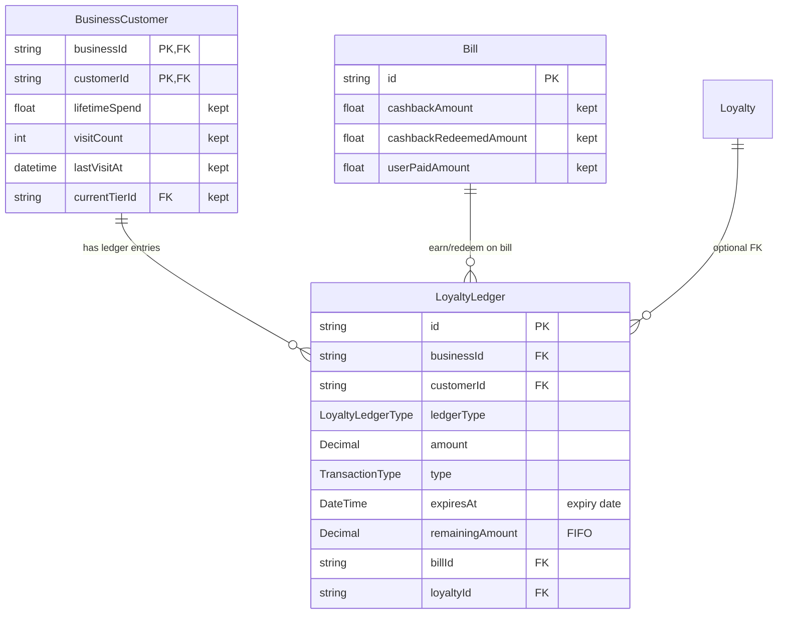

# Loyalty ledger schema update plan

## Current state (summary)

- **Two transaction tables:** [CashbackTransaction](packages/prisma/prisma/models/loyalty.prisma) (CASHBACK/TIER, amount in ₹) and [PointsTransaction](packages/prisma/prisma/models/loyalty.prisma) (AMOUNT_SPENT/VISIT_MADE, amount in points, FIFO + expiry).
- **BusinessCustomer** holds denormalized wallet/context: `pointsBalance`, `totalCashbackEarned`, `totalCashbackRedeemed`, `lifetimeSpend`, `visitCount`, `lastVisitAt`, `currentTierId`.
- **Bill** has `cashbackAmount`, `cashbackRedeemedAmount`, `userPaidAmount` and relations to `pointsTransactions` and `cashbackTransactions`.
- **Loyalty** has relation `cashbackTransactions`; config models (Cashback, Tier, AmountSpent, VisitMade) are unchanged.

---

## Target state: one ledger only

### 1. New enum and single ledger model

**File: [packages/prisma/prisma/models/enums.prisma**](packages/prisma/prisma/models/enums.prisma)

- Add **LoyaltyLedgerType** (bucket identifier; no separate “unit” field):
  - `CASHBACK` — cashback wallet (amounts in ₹)
  - `TIER_CASHBACK` — tier cashback wallet (₹)
  - `AMOUNT_SPENT_POINTS` — points from bill amount
  - `VISIT_MADE_POINTS` — points from visits

**File: [packages/prisma/prisma/models/loyalty.prisma**](packages/prisma/prisma/models/loyalty.prisma)

- Add **LoyaltyLedger** (single table for all earn/redeem/expire movements):

| Field                  | Type                        | Notes                                                                             |
| ---------------------- | --------------------------- | --------------------------------------------------------------------------------- |
| id                     | String @id @default(uuid()) |                                                                                   |
| businessId, customerId | String                      | FK to BusinessCustomer (composite)                                                |
| ledgerType             | LoyaltyLedgerType           | Which bucket (implies semantics; no unit column)                                  |
| amount                 | Decimal                     | Signed: + earn, − redeem/expire/refund/adjustment                                 |
| type                   | TransactionType             | EARNED, REDEEMED, EXPIRED, REFUNDED, GIFTED, ADJUSTMENT                           |
| source                 | TransactionSource           | BILL, FEEDBACK, SCRATCH_CARD, etc.                                                |
| billId                 | String?                     | FK to Bill (optional)                                                             |
| sourceId               | String?                     | e.g. campaign ID, scratch response ID                                             |
| **expiresAt**          | **DateTime?**               | **Expiry date** (only for EARNED in point types). See expiry edge cases below.    |
| remainingAmount        | Decimal?                    | FIFO: only on EARNED for point types; decremented on redeem/expire                |
| balanceAfter           | Decimal?                    | Optional denormalized balance per (business, customer, ledgerType) after this row |
| description            | String?                     |                                                                                   |
| metadata               | Json?                       | e.g. tier name, config snapshot                                                   |
| createdAt              | DateTime                    |                                                                                   |

- Indexes: `(businessId, customerId)`, `(businessId, customerId, ledgerType)`, `(businessId, customerId, createdAt)`, `billId`, `type`, `expiresAt`, `(type, remainingAmount)` for FIFO/expiry queries.
- Relations: `businessCustomer` (BusinessCustomer), `bill` (Bill?, optional), optionally `loyalty` (Loyalty?) if we add `loyaltyId String?`.

**Expiry date edge cases (document in schema comment or [docs](docs/)):**

- **Meaning of expiresAt:** “Valid through date X” = valid until **end of day X**. Store as end-of-day (e.g. 23:59:59.999) in a chosen timezone (UTC or business TZ).
- **Timezone:** Persist in UTC; display “expires on 15 Feb” in business/customer TZ. When computing expiresAt from `pointExpiryDays`, add days in a consistent TZ.
- **pointExpiryDays = 0:** Treat as “expire on earn date” → `expiresAt = end of day(createdAt)`.
- **pointExpiryDays = null:** Never expire → `expiresAt = null`.
- **Partial expiry:** Only the **remainingAmount** of an EARNED row is expired; create EXPIRED row with `amount = -remainingAmount`; set EARNED row `remainingAmount = 0`.
- **Expiry job:** Run after midnight (e.g. 00:05) so “valid through Feb 14” includes all of Feb 14. Select EARNED rows where `expiresAt < now()` and `remainingAmount > 0`; create EXPIRED row(s) and zero `remainingAmount`.
- **Order on bill:** When applying loyalty for a bill: run expiry for that customer first, then redemption, then earning — so balances and FIFO are correct.
- **Races:** Expiry job and bill processing: use transactional updates (e.g. lock or consistent transaction) so balance never drifts.

---

### 2. BusinessCustomer ([packages/prisma/prisma/models/customer.prisma](packages/prisma/prisma/models/customer.prisma))

**Remove (wallet stored only in ledger):**

- `pointsBalance`
- `totalCashbackEarned`
- `totalCashbackRedeemed`
- `pointTransactions` / `cashbackTransactions` relations

**Keep (context for earning rules, not wallet):**

- `lifetimeSpend` — tier placement (source of truth: sum of Bill amounts or cached)
- `visitCount`, `lastVisitAt` — VISIT_MADE qualifying logic
- `currentTierId` / `currentTier` — TIER display and rules

**Add:**

- `loyaltyLedgerEntries LoyaltyLedger[]` (or `ledgerEntries`)

Balances for UI/APIs: compute from ledger `SUM(amount) WHERE (businessId, customerId, ledgerType)` (and optionally cache in app layer or a separate WalletBalance table later if needed).

---

### 3. Bill ([packages/prisma/prisma/models/bill.prisma](packages/prisma/prisma/models/bill.prisma))

**Relations:**

- Remove: `pointsTransactions PointsTransaction[]`, `cashbackTransactions CashbackTransaction[]`.
- Add: `loyaltyLedgerEntries LoyaltyLedger[]` (or `ledgerEntries`).

**Amount fields (keep for display/snapshot):**

- Keep `cashbackAmount`, `cashbackRedeemedAmount`, `userPaidAmount` as-is for now (they reflect what was earned/redeemed on this bill for display and reporting). Alternatively, later you can generalize to a JSON breakdown by ledger type if you want one pattern for all types.

No change to `finalAmount`, `subtotal`, `storeDiscount`, `tax`, `lineItems`.

---

### 4. Loyalty ([packages/prisma/prisma/models/loyalty.prisma](packages/prisma/prisma/models/loyalty.prisma))

- Remove: `cashbackTransactions CashbackTransaction[]`.
- Optional: add `loyaltyLedgerEntries LoyaltyLedger[]` if we add `loyaltyId String?` on LoyaltyLedger (helps “all ledger rows for this program”). If we don’t add `loyaltyId` on the ledger, we can query by `(businessId, ledgerType)` only; then no relation change on Loyalty.

Recommendation: add **loyaltyId String?** on LoyaltyLedger and **loyaltyLedgerEntries** on Loyalty for clearer audit and per-program reporting.

---

### 5. Tables to remove (after migration)

- **CashbackTransaction** — replaced by LoyaltyLedger rows with `ledgerType IN (CASHBACK, TIER_CASHBACK)`.
- **PointsTransaction** — replaced by LoyaltyLedger rows with `ledgerType IN (AMOUNT_SPENT_POINTS, VISIT_MADE_POINTS)`.

Migration strategy: create LoyaltyLedger and new relations first; backfill ledger from existing CashbackTransaction and PointsTransaction; then switch application code to read/write only the ledger; then drop old tables and remove old columns (e.g. wallet fields on BusinessCustomer) in a follow-up migration.

---

## Relationship diagram (target)

---

## Files to touch (summary)

| File                                                                                           | Action                                                                                                                                          |
| ---------------------------------------------------------------------------------------------- | ----------------------------------------------------------------------------------------------------------------------------------------------- |
| [packages/prisma/prisma/models/enums.prisma](packages/prisma/prisma/models/enums.prisma)       | Add `LoyaltyLedgerType`                                                                                                                         |
| [packages/prisma/prisma/models/loyalty.prisma](packages/prisma/prisma/models/loyalty.prisma)   | Add `LoyaltyLedger`; add optional `loyaltyId` + relation; remove `CashbackTransaction`, `PointsTransaction` (after migration)                   |
| [packages/prisma/prisma/models/customer.prisma](packages/prisma/prisma/models/customer.prisma) | Remove `pointsBalance`, `totalCashbackEarned`, `totalCashbackRedeemed`, `pointTransactions`, `cashbackTransactions`; add `loyaltyLedgerEntries` |
| [packages/prisma/prisma/models/bill.prisma](packages/prisma/prisma/models/bill.prisma)         | Replace `pointsTransactions` and `cashbackTransactions` with `loyaltyLedgerEntries`                                                             |
| [docs/](docs/)                                                                                 | Add short “Loyalty ledger and expiry” note (expiry semantics and edge cases)                                                                    |

Application code that today uses `pointsBalance`, `totalCashbackEarned`, `totalCashbackRedeemed`, `PointsTransaction`, or `CashbackTransaction` will need to be updated to use LoyaltyLedger and computed/cached balances (see grep results: [lib/actions/loyalty/index.ts](apps/web/src/lib/actions/loyalty/index.ts), [api/cashier/loyalty/preview](apps/web/src/app/api/cashier/loyalty/preview/route.ts), [api/customer/loyalty](apps/web/src/app/api/customer/loyalty), BillCreationForm, customer APIs, etc.).

---

## Optional: cached balance table

If you want fast balance reads without summing the ledger every time, add a small **LoyaltyBalance** (or **WalletBalance**) table: `(businessId, customerId, ledgerType, balance, updatedAt)`, updated in the same transaction that writes LoyaltyLedger rows. This is optional and can be introduced after the ledger is in place.
