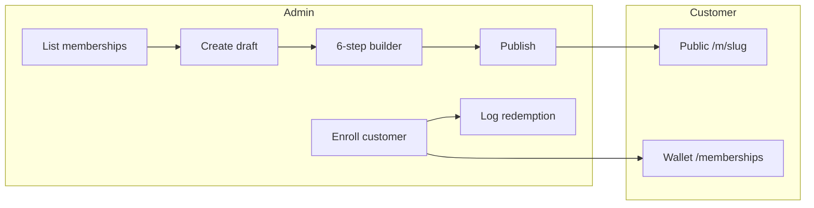
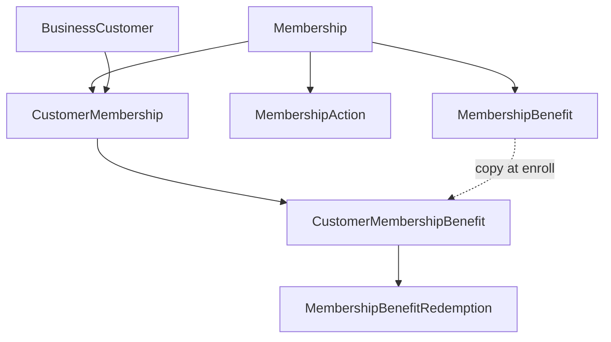

# Membership feature — implementation plan

## Current state

- **Schema** ([packages/prisma/prisma/models/membership.prisma](packages/prisma/prisma/models/membership.prisma)): `Membership`, `MembershipBenefit`, `MembershipAction` exist. Missing: `name`, `description`, validity window (`validFrom`/`validUntil`), human-readable `marketingSlug` handling, statuses PAUSED/ARCHIVED, soft delete, and any enrollment/snapshot/redemption models.
- **App**: No membership pages, API, or hooks. One reference: [ChannelSelector](apps/web/src/components/common/form-sections/ChannelSelector.tsx) comment.
- **Patterns to reuse**: 6-step builder via `LinearMultiStepFormConfig` (e.g. [LoyaltyProgramForm](apps/web/src/components/settings/loyalty/_components/LoyaltyProgramForm.tsx), [ReferralProgramForm](apps/web/src/components/settings/referral/_components/ReferralProgramForm.tsx)); list + create flow like campaigns ([CampaignsPageClient](apps/web/src/components/campaigns/CampaignsPageClient.tsx), POST draft then edit at `create/[id]`); customer portal loyalty list/detail ([apps/web/src/app/(customer)/loyalty](<apps/web/src/app/(customer)/loyalty>)); `withAdminAuth`, `getDataTableConfig`, Zod schemas, fetcher, toast.

---

## 1. Schema (Prisma)

**1.1 Membership model**

- Add `name` (String), `description` (String?, optional).
- Add validity window: `validFrom` (DateTime?), `validUntil` (DateTime?) — admin selects from calendar.
- Keep `marketingSlug` unique; add constraint/validation that it is human-readable (e.g. slug format) and set explicitly on publish (no longer default uuid in app flow; migration can keep default for existing rows).
- Add `deletedAt` (DateTime?) for soft delete. Never hard-delete if the membership has existing enrollments.
- **Enums** ([packages/prisma/prisma/models/enums.prisma](packages/prisma/prisma/models/enums.prisma)): Extend `MembershipStatus` with `PAUSED` (no new enrollments), `ARCHIVED` (hidden from lists; existing members unchanged). Keep `DRAFT`, `ACTIVE`, `INACTIVE`.

**1.2 Enrollment and snapshot**

- **CustomerMembership** (enrollment): `id`, `businessCustomerId` (BusinessCustomer), `membershipId`, `enrolledAt` (DateTime). Optional: `enrolledByAdminId` for audit. Effective validity = membership’s `validFrom`/`validUntil` (no per-enrollment end date).
- **CustomerMembershipBenefit** (snapshot at enroll): Copy of benefit at enrollment time so edits to the membership don’t change what this customer has. Fields mirror `MembershipBenefit` (type, percentage, maxRedeemableAmount, amount, minPurchaseAmount, item, points, appliesTo, specificItems), plus `customerMembershipId`, `membershipBenefitId` (original, nullable for reference). One row per benefit per enrollment.

**1.3 Redemption logging (optional but in scope)**

- **MembershipBenefitRedemption**: `id`, `customerMembershipId`, `customerMembershipBenefitId`, `redeemedAt` (DateTime), `billId` (String?, optional). Enables “log redemption” and reporting.

**1.4 Relations**

- `BusinessCustomer` → `customerMemberships CustomerMembership[]`.
- `Membership` → `customerMemberships CustomerMembership[]` (and keep existing benefit/action/terms relations).
- `CustomerMembership` → `customerMembershipBenefits CustomerMembershipBenefit[]`, `membershipBenefitRedemptions MembershipBenefitRedemption[]` (via the snapshot benefit).
- Ensure indexes for listing enrollments by business/customer and by membership.

---

## 2. Service toggle and config

- **Service key**: Add `"membership"` to [apps/web/src/lib/utils/service-enabled.ts](apps/web/src/lib/utils/service-enabled.ts) (`SERVICE_KEYS`, `DEFAULT_SERVICE_VALUES`, types). Use wherever membership feature is gated (admin list, enroll, public page).
- **Sidebar**: Add “Memberships” item (e.g. icon like CreditCard or Ticket) linking to `/memberships` in [apps/web/src/components/layouts/AppLayout/components/simple-sidebar.tsx](apps/web/src/components/layouts/AppLayout/components/simple-sidebar.tsx).
- **Route metadata**: Add entries for `/memberships`, `/memberships/create/[id]` in [apps/web/src/lib/utils/route-metadata.ts](apps/web/src/lib/utils/route-metadata.ts).
- **Proxy**: Add `/memberships` and `/memberships/` prefix to admin protected routes in [apps/web/src/proxy.ts](apps/web/src/proxy.ts).
- **Data table config**: Add `memberships` to [apps/web/src/lib/utils/data-table-params.ts](apps/web/src/lib/utils/data-table-params.ts) (prefix + filter keys e.g. name, status, marketingSlug).

---

## 3. Admin: Memberships list and create flow

- **List page**: `app/(business)/memberships/page.tsx` + `MembershipsPageClient` (table + “Create membership”).
- **Create flow**: POST creates a DRAFT membership (e.g. default name “Untitled”, `marketingSlug` = placeholder until publish); redirect to `memberships/create/[id]`. Edit page loads membership by id (scoped to admin’s business) and renders the 6-step builder.
- **API**
  - `GET /api/memberships` — list with filters (name, status, etc.), pagination, sort; scope by `admin.business.id`; exclude soft-deleted unless needed for admin.
  - `POST /api/memberships` — create draft (withAdminAuth).
  - `GET /api/memberships/[id]` — single membership with benefits, actions, terms, branding (for builder and preview).
  - `PUT /api/memberships/[id]` — update (all steps); validate at least one benefit before allowing status → ACTIVE; ensure `marketingSlug` is unique and slug-like when publishing.
  - `PATCH /api/memberships/[id]` — optional: status (DRAFT/ACTIVE/PAUSED/ARCHIVED), or soft delete (set `deletedAt` only if no enrollments, else return error).

---

## 4. Admin: 6-step membership builder

Use one form with `LinearMultiStepFormConfig` and steps:

1. **Basic info**: Name, description, validity window (validFrom, validUntil — date pickers). Optional branding (existing `brandingId` → business default or similar).
2. **Pricing**: totalPrice; internal split (platformConvenienceFee, paymentGatewayCharge, businessReceives) — for platform accounting; customer sees only total.
3. **Benefits**: At least one benefit required to publish. Repeatable benefit blocks: type (PERCENTAGE_DISCOUNT, CASH_DISCOUNT, FREE_ITEM, LOYALTY_BONUS), then type-specific fields (percentage/max, amount/min, item, points) and appliesTo (ENTIRE_PURCHASE / SPECIFIC_ITEMS) + specificItems. Reuse or mirror enums from schema.
4. **Channels**: WhatsApp, Email, SMS (reuse [ChannelSelector](apps/web/src/components/common/form-sections/ChannelSelector.tsx)).
5. **Actions (CTAs)**: List of { platform, label, url }.
6. **Preview & Publish**: Preview card (same shape as public card), Publish button (set status ACTIVE, set/confirm `marketingSlug` if not set). Generate and store QR data/URL for `/m/{marketingSlug}`.

**Schemas**: Add [apps/web/src/lib/schemas/membership.ts](apps/web/src/lib/schemas/membership.ts) (Zod) for each step and for API (create/update). Query schema for list (page, perPage, sort, name, status, etc.).

**Publish rule**: Cannot set status to ACTIVE if `membershipBenefits` length is 0; show validation error in UI and API.

---

## 5. Admin: Manual enrollment

- **Enrollment entry point**: From customer detail page ([apps/web/src/components/customers/CustomerDetailPageClient.tsx](apps/web/src/components/customers/CustomerDetailPageClient.tsx)): add “Enroll in membership” (or “Memberships” section) that opens a modal/drawer to pick a membership (only ACTIVE, not PAUSED/ARCHIVED, same business) and confirm. Alternatively or additionally: from membership detail/list, “Enroll customer” with customer search/picker.
- **API**: `POST /api/memberships/[id]/enroll` (or `POST /api/memberships/enroll` with body `{ membershipId, businessCustomerId }`). Check membership status (ACTIVE), customer belongs to business, not already enrolled in same membership. Create `CustomerMembership` and copy current `MembershipBenefit` rows into `CustomerMembershipBenefit` (snapshot). Return enrollment + snapshot.
- **Customer detail**: Show active memberships (enrollments) for that customer with membership name, validity window, and link to view benefits; optional “Log redemption” per benefit (see below).

---

## 6. Public page /m/[slug]

- **Route**: `app/(customer)/m/[slug]/page.tsx` (or equivalent public route; no auth required). Resolve membership by `marketingSlug`, ensure not deleted, and (optional) only show if ACTIVE/PAUSED for public visibility.
- **Content**: Membership card preview (name, description, branding, benefits summary, validity, CTAs). Show shareable link and QR (if stored or generated client-side). No “Express interest” form (preview + QR/link only).
- **API**: `GET /api/public/membership/[slug]` or inline in page (server component) with db lookup by `marketingSlug` and business context for branding.

---

## 7. Customer wallet (memberships)

- **API**: `GET /api/customer/memberships` — for logged-in customer, return all enrollments (CustomerMembership) with membership name, branding, validity (validFrom/validUntil), snapshot benefits (human-readable lines), and CTAs. Scope by customer (via session) and optionally filter by business. Gate by `isServiceEnabled("membership")` per business.
- **Page**: e.g. `app/(customer)/memberships/page.tsx` — list of membership cards (one per enrollment). Each card: membership name, branding, benefits list (e.g. “20% off (max ₹500)”, “Free coffee with every visit”), CTAs, validity/status. Link from customer loyalty area if desired (e.g. “Memberships” in nav or from loyalty list).
- **Proxy**: Allow `/memberships` under customer routes if we protect it (e.g. require customer session for `/memberships`), similar to `/loyalty` detail.

---

## 8. Redemption logging (minimal)

- **API**: `POST /api/memberships/enrollments/[enrollmentId]/redeem` with body e.g. `{ customerMembershipBenefitId, billId? }`. Create `MembershipBenefitRedemption`. Auth: admin or cashier for that business.
- **UI**: From customer detail (or membership enrollment block), “Log redemption” for a benefit → pick benefit from snapshot, optional bill, submit. No automatic application to bill calculation; reporting only.

---

## 9. QR and shareable link

- On publish, set `qrData` to full URL (e.g. `https://<domain>/m/{marketingSlug}`). `qrImage` can be generated server-side (e.g. with a QR library) or client-side and uploaded; alternatively store only `qrData` and generate QR image in UI when needed. Prefer minimal: store `qrData`, generate QR in admin preview and public page with a client-side QR component if available.

---

## 10. File/feature order (aligned with workspace rules)

1. **Schema** — [packages/prisma/prisma/models/membership.prisma](packages/prisma/prisma/models/membership.prisma) (and enums): add fields, CustomerMembership, CustomerMembershipBenefit, MembershipBenefitRedemption; add relation from BusinessCustomer to CustomerMembership.
2. **Schemas (Zod)** — [apps/web/src/lib/schemas/membership.ts](apps/web/src/lib/schemas/membership.ts): list query, create/update body, benefit/action/validity.
3. **API routes** — `app/api/memberships/route.ts` (GET, POST), `app/api/memberships/[id]/route.ts` (GET, PUT, PATCH), `app/api/memberships/[id]/enroll/route.ts` or `app/api/memberships/enroll/route.ts`, `app/api/customer/memberships/route.ts`, `app/api/public/membership/[slug]/route.ts` (or server-only resolution in page), `app/api/memberships/enrollments/[enrollmentId]/redeem/route.ts`.
4. **Hooks** — `hooks/membership/useMembershipQuery.ts`: useMembershipsQuery, useMembershipQuery(id), useCreateMembershipDraft, useUpdateMembership, useEnrollCustomer, useCustomerMembershipsQuery, useLogRedemption (or similar). Single file per workspace rule.
5. **Components** — `components/membership/`: MembershipsTable, MembershipsPageClient; builder steps (BasicInfoStep, PricingStep, BenefitsStep, ChannelsStep, ActionsStep, PreviewPublishStep), MembershipForm (6-step wrapper), MembershipPreviewCard; enrollment modal/picker; customer wallet cards.
6. **Pages** — `app/(business)/memberships/page.tsx`, `app/(business)/memberships/create/[id]/page.tsx`; `app/(customer)/memberships/page.tsx`; `app/(customer)/m/[slug]/page.tsx`.
7. **Config** — sidebar, route-metadata, proxy, data-table-params, service-enabled.

---

## 11. Out of scope (per your note)

- Sending messages (WhatsApp/SMS/Email) on join or for reminders/offers. Channels are stored and can be used later; no notification implementation in this plan.

---

## 12. Assumptions

- **Validity**: Only membership-level calendar window (`validFrom`/`validUntil`). Enrollment is valid whenever the current date is within that window and enrollment exists.
- **Branding**: Reuse existing optional `brandingId` (e.g. business default); no new branding model.
- **Soft delete**: If a membership has any enrollments, only allow soft delete (`deletedAt`); hide from default lists, keep data for reporting and wallet history.
- **marketingSlug**: Unique globally; validated as slug format; set/edited at latest on publish (admin can set in step 1 or 6).

---

## High-level flow (mermaid)

Data flow:

