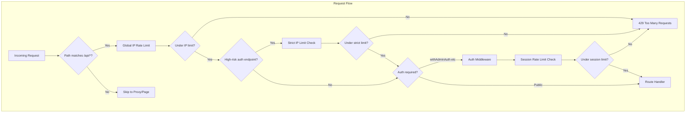

# Rate Limiting Analysis and Implementation Plan

## Current State

- **85 API routes** under `apps/web/src/app/api/`
- **Proxy** ([proxy.ts](apps/web/src/proxy.ts)) protects **page routes only**; matcher explicitly excludes `api/` routes
- **Better Auth** ([auth.ts](apps/web/src/lib/auth/auth.ts)) has built-in rate limit for admin auth only (memory, 100/min global, stricter for magic-link)
- **No rate limiting** on: cashier login, customer OTP, referral claim, public endpoints, or any sessioned APIs
- **ioredis** is available for distributed storage (optional via `REDIS_URL`)

---

## Where Rate Limiting Is Needed

### 1. Global IP Rate Limit (DoS Protection)

**Scope:** All API requests, applied before auth.

**Location:** New `middleware.ts` at `apps/web/src/middleware.ts` (or equivalent) that runs on `/api/` paths. Next.js middleware runs before route handlers and can access `request.headers` for IP extraction.

**Key:** `ip:{clientIp}`  
**Suggested:** 200–300 requests/minute per IP (configurable)

**Exclusions:**

- `/api/shopify/webhooks/` (Shopify HMAC; webhooks need higher throughput)
- `/api/loyalty/expire/run` (cron with `x-cron-secret`; server-to-server)

---

### 2. Auth / High-Risk Public Endpoints (Strict IP + Optional Identifier)

| Endpoint                                        | Risk                             | Suggested Limit               |
| ----------------------------------------------- | -------------------------------- | ----------------------------- |
| `POST /api/auth/cashier/login`                  | Brute force, credential stuffing | 5/min per IP                  |
| `POST /api/auth/customer/register-request-otp`  | OTP/SMS/email spam               | 3/10min per IP (or per phone) |
| `POST /api/auth/customer/verify-otp`            | OTP brute force                  | 5/min per IP                  |
| `POST /api/referral/claim`                      | Referral abuse                   | 5/min per IP                  |
| `GET /api/public/business/[slug]/register-info` | Scraping                         | 30/min per IP                 |
| `POST /api/auth/revoke`                         | Session revocation abuse         | 10/min per IP                 |

---

### 3. Other Public Endpoints (Moderate IP Limit)

| Endpoint                                            | Method                                     | Suggested Limit |
| --------------------------------------------------- | ------------------------------------------ | --------------- | ------------------------------------ |
| `GET /api/referral/program/[businessSlug]`          | GET                                        | 60/min per IP   |
| `GET /api/referral/program/by-claim/[referralSlug]` | GET                                        | 60/min per IP   |
| `GET                                                | POST /api/feedback/[businessSlug]/[token]` | GET + POST      | 30/min per IP (POST stricter: 5/min) |
| `GET /api/onboarding/business-slug`                 | GET                                        | 60/min per IP   |

---

### 4. Session-Based Rate Limit (Per User/Session)

**Scope:** All APIs using `withAdminAuth`, `withAdminAuthOptionalBusiness`, `withCashierAuth`, `withCustomerAuth`.

**Key:** `session:{sessionId}` or `user:{userId}` (session preferred for “session-wise” behavior)

**Suggested:** 100–200 requests/minute per session (higher than IP limit for normal usage)

**Implementation:** Wrap or extend the auth middleware in [lib/auth/middleware.ts](apps/web/src/lib/auth/middleware.ts) so rate limit runs after auth, using `context.session.token` or `context.session.id`.

**Affected route groups:**

- Admin: analytics, bills, campaigns, categories, customers, feedback, loyalty, message-logs, partnership, referral (logs/program/stats), shopify, sku, onboarding, business
- Cashier: cashier/bill, cashier/bills, cashier/customer/search, cashier/loyalty/preview, cashier/next-bill-number, cashier/sku
- Customer: customer/loyalty, customer/loyalty/[businessSlug]

---

### 5. Endpoints to Exclude or Treat Differently

| Endpoint                                        | Reason                                                     |
| ----------------------------------------------- | ---------------------------------------------------------- |
| `/api/auth/admin/`                              | Better Auth already rate limits                            |
| `/api/shopify/webhooks/orders`                  | HMAC verified; Shopify-controlled volume                   |
| `/api/loyalty/expire/run`                       | Cron with secret; server-to-server                         |
| `/api/shopify/callback`, `/api/shopify/install` | OAuth flows; rely on global IP limit or light custom limit |

---

## Architecture Overview

---

## Implementation Approach

### Option A: Middleware + Route-Level Helpers

1. `**src/middleware.ts**` (Next.js middleware)

- Run only on `/api/*`
- Apply global IP rate limit
- Apply strict limits for known high-risk paths (cashier login, OTP, referral claim, etc.)
- Return 429 with `Retry-After` when exceeded

1. `**lib/ratelimit/**`

- `createRateLimiter(storage)` – factory for IP/session limiters
- `withIpRateLimit(limit)` – helper for route-level IP limits
- `withSessionRateLimit(limit)` – wrapper to use inside auth middleware

1. **Auth middleware** ([lib/auth/middleware.ts](apps/web/src/lib/auth/middleware.ts))

- Add optional `withSessionRateLimit` step after auth, before calling handler
- Or create `withAdminAuthAndRateLimit`, etc., that compose auth + session limit

### Option B: Single Middleware for IP, Composable Wrappers for Session

1. `**src/middleware.ts`

- Global IP limit on `/api/`
- Path-specific strict limits for auth/OTP/referral endpoints

1. **Auth wrappers**

- Add `rateLimitSession()` call at the start of each `with*Auth` before DB lookups, or
- Create `withRateLimitedAuth` that wraps `withAdminAuth` etc. and adds session limit

### Storage

- **Development:** In-memory (Map or similar)
- **Production:** Redis via `ioredis` when `REDIS_URL` is set; fallback to memory
- **Better Auth:** Already uses `storage: "memory"`; consider Redis for multi-instance deployments

---

## File Changes Summary

| File                                  | Change                                                                                |
| ------------------------------------- | ------------------------------------------------------------------------------------- |
| `apps/web/src/middleware.ts`          | **New** – global IP rate limit + strict limits for auth/OTP/referral                  |
| `apps/web/src/lib/ratelimit/`         | **New** – rate limit utilities, storage adapters                                      |
| `apps/web/src/lib/auth/middleware.ts` | Add session rate limit step to `withAdminAuth`, `withCashierAuth`, `withCustomerAuth` |
| `apps/web/package.json`               | Add `@upstash/ratelimit` or similar (optional; can implement custom with ioredis)     |

---

## Recommended Limits (Configurable via Env)

| Limit Type                       | Default | Env Var                        |
| -------------------------------- | ------- | ------------------------------ |
| Global IP                        | 250/min | `RATELIMIT_IP_MAX`             |
| Session (admin/cashier/customer) | 150/min | `RATELIMIT_SESSION_MAX`        |
| Cashier login                    | 5/min   | `RATELIMIT_CASHIER_LOGIN_MAX`  |
| OTP request                      | 3/10min | `RATELIMIT_OTP_REQUEST_MAX`    |
| OTP verify                       | 5/min   | `RATELIMIT_OTP_VERIFY_MAX`     |
| Referral claim                   | 5/min   | `RATELIMIT_REFERRAL_CLAIM_MAX` |
