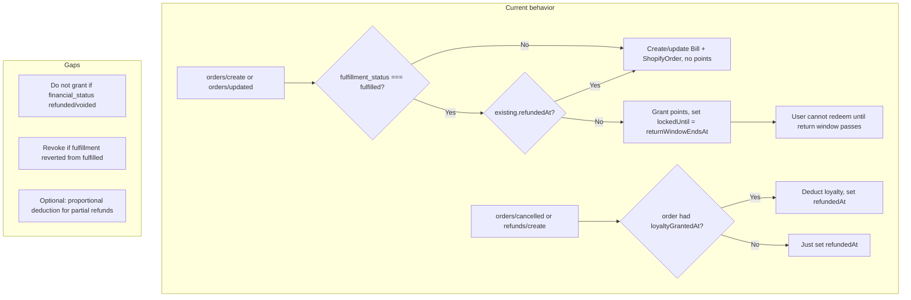

# Shopify order loyalty: current behavior and gaps

## What you already have

### 1. When points are granted

- Points are granted **only when** `fulfillment_status === "fulfilled"` in [webhooks/orders/route.ts](apps/web/src/app/api/shopify/webhooks/orders/route.ts) (around line 423).
- So: order created → no points. Order fulfilled → we grant. Order cancelled before fulfillment → we never granted, so nothing to revoke.

### 2. Lock until return window (no spend until safe)

- When we grant, we set `returnWindowEndsAt = now + returnWindowDays` (e.g. 7 days) on `ShopifyOrder` and pass it into [applyLoyaltyForShopifyOrder](apps/web/src/lib/actions/loyalty/shopify-order.ts), which stores `metadata.lockedUntil = returnWindowEndsAt` on the EARNED transaction.
- [getLockedShopifyBalance](apps/web/src/lib/actions/loyalty/index.ts) sums EARNED SHOPIFY_ORDER transactions where `lockedUntil > now`.
- Redeem logic in [getRedeemableInfo](apps/web/src/lib/loyalty/redeem-info.ts) (and loyalty apply flows) subtracts this locked amount from wallet balance to get **effective** balance. So the user **cannot redeem** Shopify-earned points until the return window has passed.

So: **lock-until is implemented** — users do not get to spend those points until after the return window.

### 3. Cancel and refund handling

- **orders/cancelled**: We find the `ShopifyOrder`, and if we had granted loyalty we call [deductLoyaltyForShopifyOrderRefund](apps/web/src/lib/actions/loyalty/shopify-order.ts), then set `refundedAt` and `financialStatus: voided`.
- **refunds/create**: Same — deduct if loyalty was granted, set `refundedAt` and `financialStatus: refunded`.
- We **never re-grant** after a refund: in orders/create and orders/updated we bail out if `existing?.refundedAt` (or `existing?.loyaltyGrantedAt` when we’re about to grant).

So: **order placed then cancelled, or order fulfilled then refunded/cancelled** are covered — we either never grant or we deduct.

---

## Edge cases and gaps (per Shopify)

### Gap 1: Grant when order is already refunded/voided

- **Issue:** We only look at `fulfillment_status === "fulfilled"`. We do **not** check `financial_status`. Shopify can send `orders/updated` with `fulfillment_status: fulfilled` and `financial_status: refunded` or `voided` (e.g. refund already processed).
- **Effect:** We may grant points, then a moment later `refunds/create` (or a prior `orders/cancelled`) has already set `refundedAt`, or we grant and then the next webhook deducts — so we might briefly show points or do grant-then-deduct.
- **Recommendation:** Before granting, skip when `financial_status` is `refunded` or `voided` so we never grant for orders that are already financially closed.

### Gap 2: Fulfillment reverted (fulfilled → not fulfilled)

- **Issue:** If Shopify allows an order to go from “fulfilled” back to “partially_fulfilled” or “restocked” / “unfulfilled”, we only get `orders/updated`. We do not currently **revoke** loyalty when fulfillment status drops from fulfilled.
- **Effect:** Customer could keep points for an order that is no longer considered fulfilled.
- **Recommendation:** On `orders/updated`, if we already have `existing?.loyaltyGrantedAt` and current `fulfillment_status !== "fulfilled"`, treat like a refund: deduct loyalty and set `refundedAt` (or a dedicated “reversed” state). Depends whether your Shopify flow ever reverts fulfillment; if yes, this should be handled.

### Gap 3: Partial refunds (all-or-nothing deduction)

- **Issue:** We treat the first refund as full: we deduct **all** loyalty for that order and set `refundedAt`. Any further `refunds/create` (e.g. second partial refund) are no-ops because `refundedAt` is already set.
- **Effect:** One partial refund revokes 100% of that order’s points. Multiple partial refunds don’t double-deduct (good), but we don’t do proportional deduction per refund amount.
- **Recommendation:** If you need proportional behavior (e.g. refund 50% of order → revoke 50% of points), you’d need to use refund amount/line items from the payload and deduct proportionally, and only set “fully refunded” when the sum of refunds covers the order (or when Shopify sends a “full” refund). Otherwise, current all-or-nothing is acceptable if that’s the business rule.

### Gap 4: No explicit handling of “order deleted”

- **Issue:** Shopify has an “order deleted” (or similar) event in some APIs. If you add it later, you’d want to treat it like cancel: ensure no points remain and no one can spend (deduct if we had granted, set state so we never re-grant). Not applicable until you subscribe to such an event.

---

## Summary diagram

---

## What to do next (no code in this plan)

1. **financial_status:** Add a guard so we never grant when `financial_status` is `refunded` or `voided`.
2. **Fulfillment reverted:** If your Shopify setup can “unfulfill” orders, add logic on `orders/updated` to revoke (deduct + set refundedAt) when we had granted but now `fulfillment_status !== "fulfilled"`.
3. **Partial refunds:** Decide policy (all-or-nothing vs proportional). If proportional, extend refund handling to use refund amount and deduct proportionally; else leave as-is and document that one refund = full revoke for that order.
4. **Order deleted:** When/if you add a webhook for order deletion, treat it like cancel (deduct if granted, mark so we never re-grant).

No changes are required for “order placed then cancelled” (we don’t grant) or “lock until return window” (already implemented in redeem logic via locked balance).
