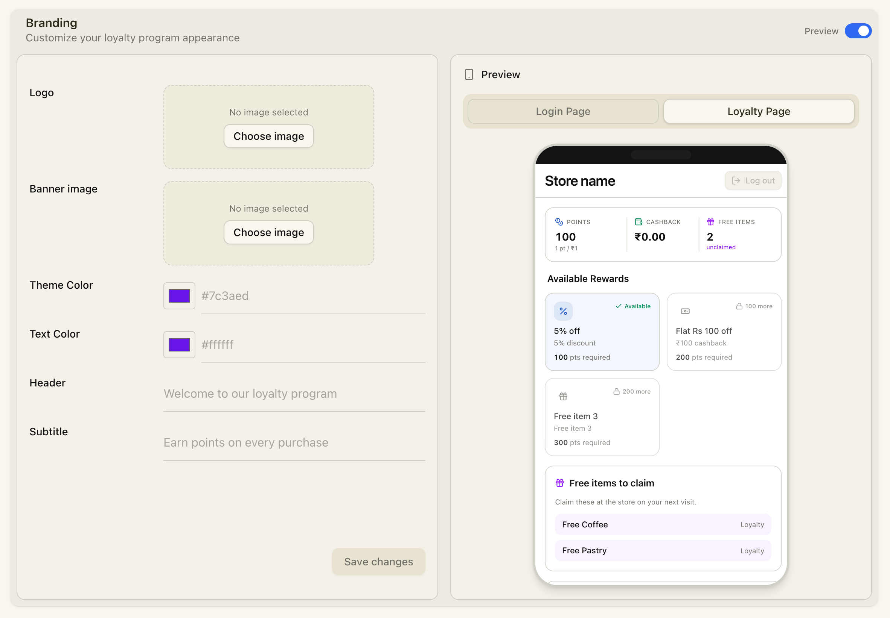
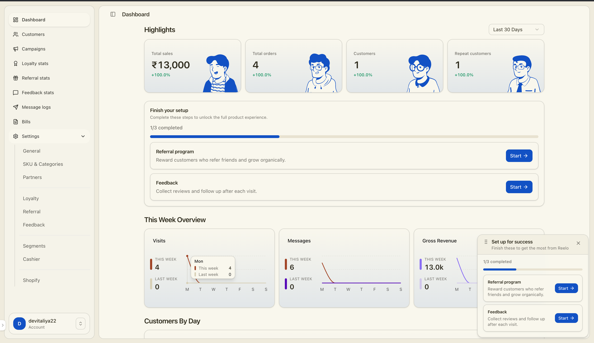
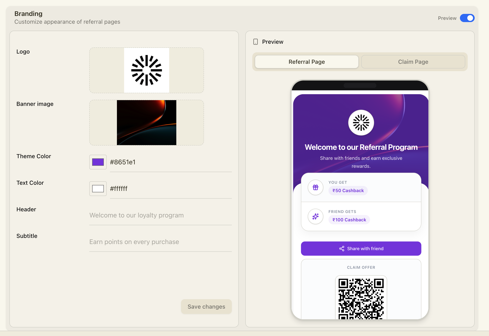
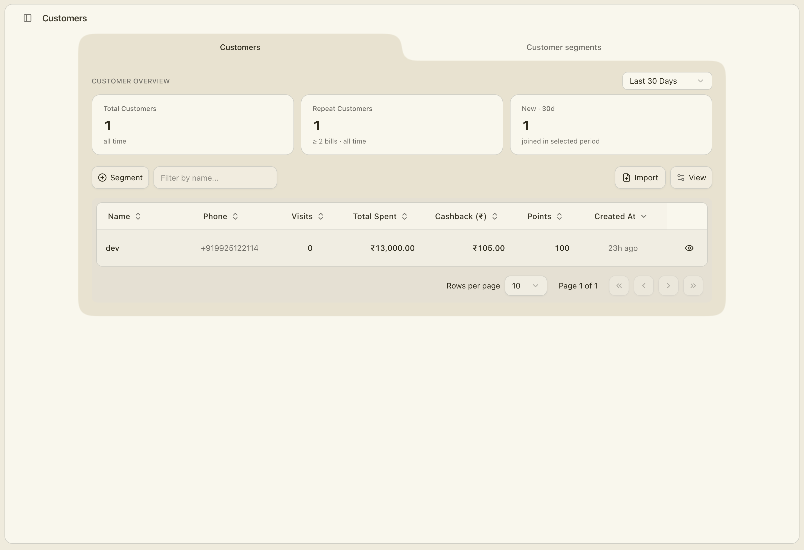
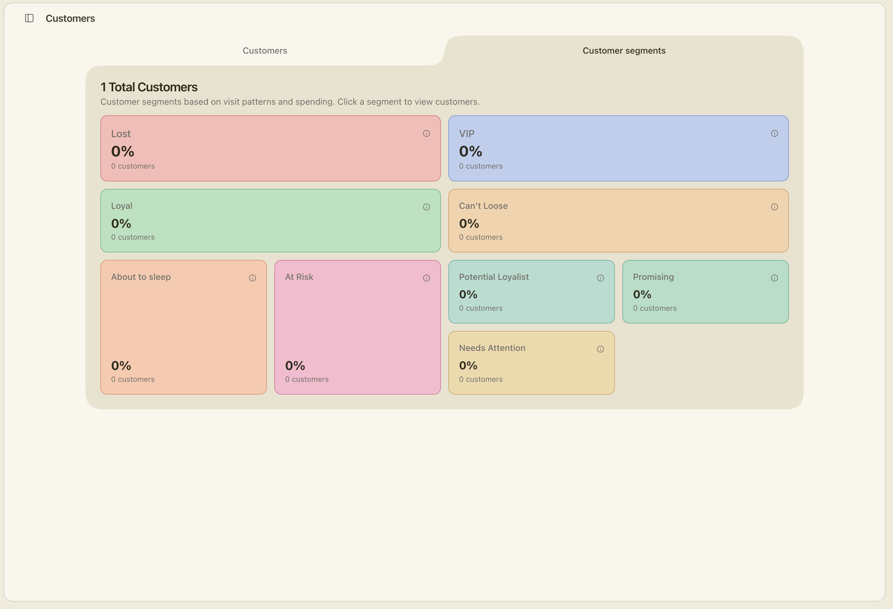

<div align="center">
  <h1>retention.sh</h1>
  <p>Customer retention and loyalty platform for modern businesses.</p>
  <p>
    <a href="https://dyweb.devitaliya.me/">Portal</a> ·
    <a href="https://dy.devitaliya.me/">Landing Page</a>
  </p>
</div>

## Screenshots







This monorepo contains:

- A product web app for operating loyalty, referrals, feedback, campaigns, and cashier workflows
- A marketing landing site
- Shared packages for database access, UI components, and transactional emails

## What We Are Building

From the product and domain model structure, this platform is designed to help businesses:

- Run flexible loyalty programs (cashback, tier-based, amount-spent points, visit-based points)
- Manage referrals with separate new-customer and existing-customer incentives
- Collect feedback, route negative alerts, and request public reviews
- Launch targeted campaigns with rewards and scheduling
- Operate cashier and billing flows with wallet/transaction tracking
- Connect Shopify stores and handle order-based loyalty (including return-window locks)
- Orchestrate customer messaging across WhatsApp, email, and SMS

## Monorepo Structure

`apps/`

- `web` - Main product app (Next.js)
- `landing` - Marketing website (Next.js)

`packages/`

- `prisma` (`@reelo/db`) - Prisma schema, migrations, and generated client
- `ui` (`@reelo/ui`) - Shared UI component library
- `transactional` (`@reelo/transactional`) - Transactional email templates
- `eslint-config`, `typescript-config` - Shared tooling configs

## Tech Stack

- Next.js 16 + React 19
- Prisma + PostgreSQL
- Redis (optional but supported in local setup)
- Turbo + pnpm workspaces

## Quick Start

### 1) Requirements

- Node.js `>=22`
- `pnpm` (workspace uses `pnpm@10`)
- Docker (for local Postgres/Redis)

### 2) Install

```bash
pnpm install
```

### 3) Configure environment files

Create local env files from examples:

```bash
cp apps/web/.env.example apps/web/.env
cp packages/prisma/.env.example packages/prisma/.env
```

Notes:

- Local Postgres runs on port `5433` via `docker-compose.yml`
- Update API keys/secrets in `apps/web/.env` as needed

### 4) Start local services

```bash
pnpm db:start
```

### 5) Generate Prisma client and run migrations

```bash
pnpm --filter=@reelo/db db:generate
pnpm --filter=@reelo/db db:migrate
```

### 6) Start apps

Run everything via Turbo:

```bash
pnpm dev
```

Or run specific apps:

```bash
pnpm --filter web dev
pnpm --filter landing dev
```

## Common Commands

- `pnpm dev` - Start workspace dev pipelines
- `pnpm build` - Build all packages/apps
- `pnpm lint` - Lint all workspaces
- `pnpm format` - Prettier write
- `pnpm db:start` / `pnpm db:stop` - Start/stop local Postgres + Redis

## Domain Summary (High-Level)

The data model indicates a business-centric product:

- Business, admin, cashier, and customer roles
- Bills, wallets, and typed transactions (`EARNED`, `REDEEMED`, etc.)
- Loyalty + reward stages + expiry/reminder messaging
- Referral logs and reward unlocking rules
- Feedback links per bill and structured feedback responses
- Campaign lifecycle (draft/active/expired) and reward logic
- Shopify store, order sync, and return-window-aware loyalty unlock

## Notes

- See `apps/landing` for marketing positioning and feature framing.
- See `packages/prisma/prisma` for the source-of-truth domain model.
